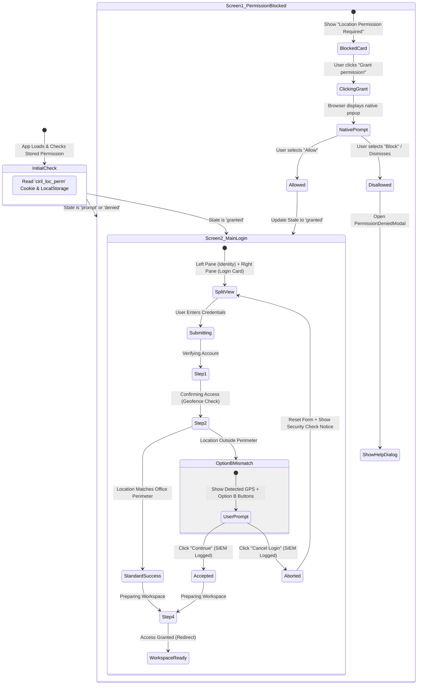
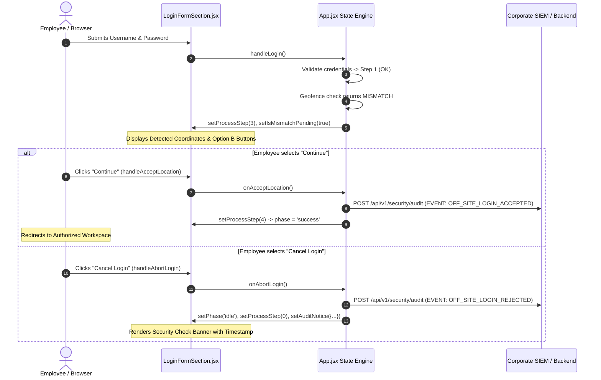

# CIRIL IOTS — Login Section & User Experience Flow

> **Scope:** Front-End Architecture of the Login Interface  
> **Target Audience:** UI/UX Designers, Product Managers, Frontend Engineers, Security Personnel  
> **Status:** Current Production Architecture

---

## 1. Overview & Dual Screen Experience

The IOTS login system functions as a gated, zero-trust portal. An employee encounters one of two screens depending on whether location permissions have been granted:



---

## 2. Screen 1: The Location Permission Gate

### The Layman's Perspective
When you visit the login page for the first time, you are greeted with a polite security check: *"Location Permission Required"*. We don't ask for your location to be invasive; we ask because CIRIL requires all employee log-ins to be verified for corporate safety.
- You see clear instructions: 
  1. Click the lock/settings icon next to the web address.
  2. Set **Location** to **Allow**.
  3. Click **Grant permission!**.
- When you click the button, it smoothly changes to a golden spinner saying *"Checking..."* so you know the system is waiting on your browser.

### The Technical Perspective
- **Gating Mechanism:** In `App.jsx`, when `locationPermissionState === 'denied' || locationPermissionState === 'prompt'`, the entire login form is withheld from rendering. This fulfills corporate requirement #4: *disabling view access to the login pane until location telemetry can be established*.
- **Single Buffering State:** The button maintains `isVerifyingPermission` state. When pressed, the button disables itself (`pointer-events: none`, reduced opacity), swaps its icon for `.spinner-brand`, and initiates `navigator.geolocation.getCurrentPosition`.
- **Local Protocol Graceful Degradation:** If developers test locally via `file://` or non-HTTPS origins where Chromium natively denies GPS without prompting, the engine detects this condition (`error.code === 1 && window.location.protocol === 'file:'`) and falls back to a mock operational node so developers can continue working offline.

---

## 3. Screen 2: The Main Login Interface

Once permission is established, the application displays a modern, dual-pane responsive layout:

```
┌──────────────────────────────────────────────┬──────────────────────────────────────────────┐
│ LEFT PANE: BRAND & LIVE GPS TELEMETRY        │ RIGHT PANE: GLASSMORPHIC LOGIN CARD          │
│                                              │                                              │
│ [ CIRIL Corporate Logo ]                     │ [ Secure Login Portal ]                      │
│                                              │                                              │
│ Internal Operations                          │ System Access                                │
│ Tracking System                              │ Login with your organizational identity.     │
│ (Dynamic Typing Effect)                      │                                              │
│                                              │ [ Username or E-mail: account@ciril.in     ] │
│ "A centralized secure platform..."           │ [ Password: ••••••••••••                 👁 ] │
│                                              │                                              │
│ [ Live GPS Telemetry Card ]                  │ [ Recovery Process ]          [ Login 🔓 → ] │
│ • Status: GPS Satellite Fix (±3.8m)          │                                              │
│ • Area: HITEC City, Hyderabad                └──────────────────────────────────────────────┘
│ • Lat: 17.448291° N | Lon: 78.374829° E      │ FOOTER: Authorized personnel only. Audited.  │
└──────────────────────────────────────────────┴──────────────────────────────────────────────┘
```

### Responsive Adaptability
- **Desktop (≥ 1024px):** Split-screen experience (`lg:flex-row`). The left pane showcases corporate branding and the high-precision GPS card, while the right pane holds the form.
- **Mobile (< 768px):** The introductory description is hidden (`hidden md:block`) and the large telemetry box is replaced by a sleek, compact mobile telemetry pill (`flex md:hidden`) pinned above the form. This keeps the username and password fields strictly **above the fold** without requiring the employee to scroll down on small smartphones.

---

## 4. Visual Polish & Micro-Interactions

### A. The WebGL Simplex-Noise Shader (`SimplexNoiseBackground.jsx`)
- **Layman's View:** A subtle, living background that shifts and flows like gentle water or moving clouds. It makes the site feel alive and premium, like an executive boardroom display.
- **Technical View:** A hardware-accelerated WebGL canvas. Rather than using heavy video files or complex SVG animations that bog down the CPU, it runs a raw GLSL shader compiled on the GPU:
  - **Algorithm:** Domain-warped fractional Brownian motion (fBm) based on 2D simplex noise.
  - **Dynamic Theme Interpolation:** When the user switches between Dark and Light mode, the uniform `u_dark` smoothly interpolates using an exponential smoothing formula:
    $$\text{darkCurrent} = \text{darkCurrent} + (\text{darkTarget} - \text{darkCurrent}) \times 0.08$$
  - **Performance Optimization:** Resizes dynamically using `devicePixelRatio` capped at `1.5` to prevent battery drain on 4K/Retina displays. On component unmount, all GL programs, shaders, and frame buffers are deleted to eliminate memory leaks.

### B. Minimal Typing Title (`MinimalTypingTitle.jsx`)
- **Layman's View:** The text "Internal Operations" types itself out, followed by "Tracking System" in warm gold. Once finished, the cursor gently disappears so it never distracts you while typing your password.
- **Technical View:** A layout-stable React component. Unlike naive typing effects that cause elements below to jump around as letters appear, this component reserves exact line heights (`min-h-[1.2em]`).
  - Phase 1: Types "Internal Operations" (45ms per char).
  - Phase 2: Shifts cursor to Line 2 and types "Tracking System" (50ms per char).
  - Phase 3: A 500ms timer runs, after which `cursorStage` becomes `'done'`, completely unmounting the blinking cursor element.

### C. Unlocking Padlock Physics (`UnlockingLock.jsx` & `AnimatedButton.jsx`)
- **Layman's View:** When your mouse hovers over the "Login" button, the little padlock visibly pops its shackle open as if welcoming you in.
- **Technical View:** SVG shackle path transformed via CSS with a custom spring easing curve:
  ```css
  transform-origin: 16px 11px;
  transition: transform 500ms cubic-bezier(0.34, 1.56, 0.64, 1);
  ```
  On hover, it translates `-1.5px` and rotates `24deg`. On active press (`:active`), it snaps shut (`rotate(0deg)` in `150ms`), giving tactile haptic feedback to the click.

---

## 5. The 4-Step Authentication Pipeline

Once the employee clicks **Login**, the card transitions from the form view to the live authentication progress state machine:

```
[ Active Shimmer Bar ] ═══════════════════════════════════════
Step 1: 🟢 Verifying Your Account
        "ID_EMP204 Your account has been verified successfully."

Step 2: 🟢 Confirming Your Access
        "GPS Locked: 17.448291° N, 78.374829° E (±3.8m)"

Step 3: 🟢 Checking Workplace Geofence
        "Your location matches allowed locations."

Step 4: 🟡 Preparing Your Workspace
        "Your access to workspace is ready to open."
```

### Stage Transitions in Code
1. **Validation Check:** Verifies `empId` and `password` are non-empty. If blank, triggers `EmptyCredsModal`.
2. **`phase = 'processing'`, `processStep = 1`:** Triggers gold shimmer progress bar and checks account database.
3. **`processStep = 2`:** Queries the geofencing service with live GPS coordinates.
4. **`processStep = 3`:**
   - **If Authorized Location:** Displays green verification badge and proceeds to Step 4.
   - **If Location Mismatch Detected:** Pauses the pipeline and activates the **Option B Mismatch Flow**.
5. **`processStep = 4`, `phase = 'success'`:** Workspace initialization complete. Ready for route transition.

---

## 6. Option B: Location Mismatch Decision Flow

### The Layman's Perspective
What happens if you are traveling, working from a client site, or working from home, and your GPS coordinates don't match the office?
- In rigid systems, you are abruptly kicked out with an error.
- In CIRIL IOTS, the portal respects that business happens everywhere. It politely informs you:
  *"GPS Location Mismatch Detected. Your current GPS coordinates do not match the registered authorized workplace location."*
- It presents your detected coordinates and neighborhood for transparency, and gives you two clear choices:
  1. **Continue (Gold Button):** Acknowledges that you are logging in off-site. The system logs this for security compliance and opens your workspace.
  2. **Cancel Login (Red Outline Button):** If you suspect someone else is logging in or you made a mistake, you can abort. The system resets the form and shows an official confirmation banner: *"Security Check Recorded. User rejected off-site login attempt at 10:14 AM."*

### The Technical Perspective (State Machine & Telemetry)



---

## 7. Dialog & Modal Ecosystem

All modals are rendered at the root layer of `App.jsx` with `z-50` backdrop-blur overlays, preventing background interactions while active:

| Modal Component | Trigger Condition | Content & Instructions | Action on Close |
| :--- | :--- | :--- | :--- |
| **`EmptyCredsModal.jsx`** | User clicks submit while username or password is empty | Amber caution icon. *"Please provide your Username or E-mail and Password to enter the system."* | Closes modal and automatically executes `.focus()` on the first empty input element. |
| **`HelpModal.jsx`** | User clicks *"Recovery Process"* link | Gold shield icon. *"Password reset is unavailable. Please contact your Department Administrator or IT Service Desk to request an access."* | Closes modal. |
| **`PermissionDeniedModal.jsx`** | User clicked *"Grant permission!"* but browser rejected | Rose warning icon. *"Location permission was not granted. Click the permissions icon next to the address bar, set Location to Allow, and click Grant permission again."* | Closes modal and leaves user on the permission gate screen. |

---

## 8. Engineer's Testing Dock (`TestingDock.jsx`)

To ensure that QA testers, frontend engineers, and executive reviewers can test all scenarios without needing to spoof GPS hardware or alter browser permissions, a testing dock is pinned to the bottom right:

1. **`1. Success` Button:** Sets `activeScenario = 'success'`. Simulates entering credentials within authorized premises.
2. **`2. Failed` Button:** Sets `activeScenario = 'failed'`. Simulates bad credentials, throwing: *"Authentication failed. Invalid credentials are given."*
3. **`3. Mismatch` Button:** Sets `activeScenario = 'mismatch'`. Triggers the Option B off-site decision interface.
4. **GPS Fix Monitor:** Displays live accuracy (e.g. `±3.8m`) and current coordinates.
5. **Loc. Permission Toggle:** Toggles the stored cookie and state between `granted` and `denied`, allowing instant preview of Screen 1 vs Screen 2.
