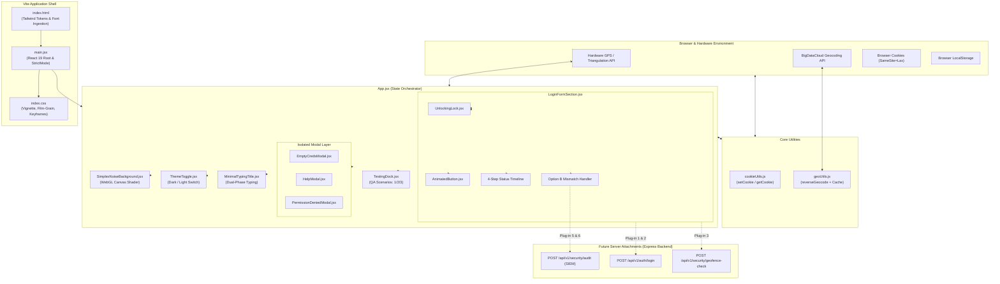

# CIRIL Internal Operations Tracking System (IOTS)
## Frontend Documentation Suite — Master Index & Architecture Overview

> **Version:** 1.0.0 (Production Architecture)  
> **Target Application:** `iots-app/frontend/iots-app`  
> **Framework:** React 19.x + Vite 8.x + Tailwind CSS + WebGL  
> **Linter:** Oxlint (0 Warnings, 0 Errors)  
> **Location:** `\internal-operations-tracking-system\iots-app\documentation\`

---

## 1. Executive Summary

### The Layman's Perspective: What is this Portal?
Imagine entering a modern, high-security corporate facility. Before you can swipe your badge, a friendly digital concierge checks two things: **Who are you?** (your credentials) and **Where are you?** (ensuring you are physically within an authorized workplace or designated operational area). 

The **Internal Operations Tracking System (IOTS)** login portal is CIRIL's digital front door. It is designed to be elegant, lightning fast, and reassuring. Instead of cold, confusing error messages, it clearly explains why location is needed, offers simple one-click guidance if permissions need enabling, provides an interactive recovery route if you forget your password, and gives you transparent control if you are working remotely or outside the standard office perimeter.

### The Technical Perspective: What did we build?
The IOTS frontend is a modern, modular, single-page application built on **React 19** and bundled with **Vite 8**. It transitions away from monolithic, legacy HTML/JS files into an enterprise-grade component architecture:

```
Monolithic new_login_react.html (1,840 lines)
                     │
                     ▼ Bifurcated & Modularized
┌────────────────────────────────────────────────────────┐
│  • 14 Standalone SVG Vector Components (Icons.jsx)      │
│  • GPU-Accelerated WebGL Simplex Noise Canvas           │
│  • High-Precision Geolocation & Sub-Meter GPS Engine   │
│  • Reverse Geocoding with Euclidean Cache (geoUtils.js)│
│  • Dual-Storage Lax Cookie + LocalStorage Engine       │
│  • Composed Glassmorphic Login Form Section            │
│  • 3 Isolated Modal Dialogs (Empty, Recovery, Blocked) │
│  • 6 Explicit Server Plug-in Hooks ([PLUG-IN 1 to 6])  │
│  • Scenario Testing Dock for Rapid QA Simulation       │
└────────────────────────────────────────────────────────┘
```

The system operates with **zero external icon dependencies** (reducing bundle bloat), uses hardware-accelerated shaders for 60fps animations without burning CPU cycles, and adheres to strict Oxlint standards with zero lint warnings and zero errors.

---

## 2. Documentation Sitemap

This documentation suite is split into specialized, deep-dive guides:

| File | Focus Area | Intended Audience |
| :--- | :--- | :--- |
| [**`01_FOLDER_STRUCTURE_AND_MAPPING.md`**](./01_FOLDER_STRUCTURE_AND_MAPPING.md) | Full directory hierarchy, notes on every folder/file, component mapping graph, design tokens. | Developers, Architects, Code Reviewers |
| [**`02_LOGIN_SECTION_AND_UX_FLOW.md`**](./02_LOGIN_SECTION_AND_UX_FLOW.md) | Complete login UX walkthrough, state machines, WebGL shaders, visual polish, and Option B decision tree. | Product Managers, UI/UX Designers, Frontend Engineers |
| [**`03_GEOLOCATION_AND_SECURITY_ENGINE.md`**](./03_GEOLOCATION_AND_SECURITY_ENGINE.md) | Sub-meter GPS telemetry, BigDataCloud reverse geocoding, cookie syncing, security threat models. | Security Officers, Compliance, Full-Stack Engineers |
| [**`04_SERVER_ATTACHMENTS_AND_API_BLUEPRINT.md`**](./04_SERVER_ATTACHMENTS_AND_API_BLUEPRINT.md) | Backend integration guide, Express.js blueprints, 6 plug-in hooks, SIEM audit payloads, and schemas. | Backend Developers, DevOps, System Administrators |

---

## 3. High-Level System Architecture

The following Mermaid diagram illustrates how the frontend components, utilities, state handlers, and browser hardware APIs communicate with each other:



---

## 4. Quick Start & Developer Guide

### Prerequisites
- **Node.js**: v18.0.0 or higher (v20+ recommended)
- **Package Manager**: `npm` (v9+)

### Installation
Navigate to the frontend project root:
```powershell
cd C:\Users\ciril\OneDrive\Desktop\Manikanta-Files\Git\monitoring-portal\internal-operations-tracking-system\iots-app\frontend\iots-app
npm install
```

### Running the Development Server
Starts the Vite server with Hot Module Replacement (HMR):
```powershell
npm run dev
```
The server will boot locally at `http://localhost:5173/`.

### Linting (Oxlint)
Runs the ultra-fast Rust-based Oxlint engine across the entire codebase:
```powershell
npx oxlint
```
*Current benchmark result:* `Found 0 warnings and 0 errors across 16 files (161ms).`

### Production Build
Bundles and minifies all assets into the `dist/` directory:
```powershell
npm run build
```
*Current benchmark result:* `Built client environment in 555ms.`

### Testing Scenarios (In-Browser)
When the application is running in development or testing mode, a floating dock is pinned to the bottom right of the screen:
1. **Scenario 1 (Success):** Simulates an employee at the authorized corporate premises with valid credentials.
2. **Scenario 2 (Failed):** Simulates an invalid credentials error.
3. **Scenario 3 (Mismatch):** Simulates an employee attempting login from outside the workplace perimeter, triggering the Option B decision workflow (`Continue` vs `Cancel Login`).
4. **Loc. Permission Toggle:** Instantly flips the stored permission between Granted and Blocked to test the permission onboarding screen without altering native browser settings.

---

## 5. Technology Stack Summary

| Layer | Technology | Version | Purpose |
| :--- | :--- | :--- | :--- |
| **Core UI** | React | `^19.2.8` | Declarative component model and state hooks |
| **Tooling & Bundler** | Vite | `^8.3.1` | Ultra-fast ES-module dev server and Rollup production build |
| **Styling** | Tailwind CSS | v3.4 (CDN runtime) | Utility-first styling with exact corporate token mapping |
| **Shader Graphics** | WebGL 1.0 (GLSL) | Native | Domain-warped fractional Brownian motion simplex noise |
| **Quality & Linting** | Oxlint | `^1.81.0` | Rust-based linter enforcing clean, safe React 19 standards |
| **Geospatial API** | W3C Geolocation | Native | Hardware satellite and network coordinate acquisition |
| **Reverse Geocoder** | BigDataCloud API | Client v1 | Converting coordinates to locality and administrative divisions |
| **Typography** | Google Fonts | Web | `Inter` (sans-serif) and `JetBrains Mono` (monospace) |

---

*Continue reading the specialized chapters listed in the [Documentation Sitemap](#2-documentation-sitemap) for in-depth technical specifications.*
