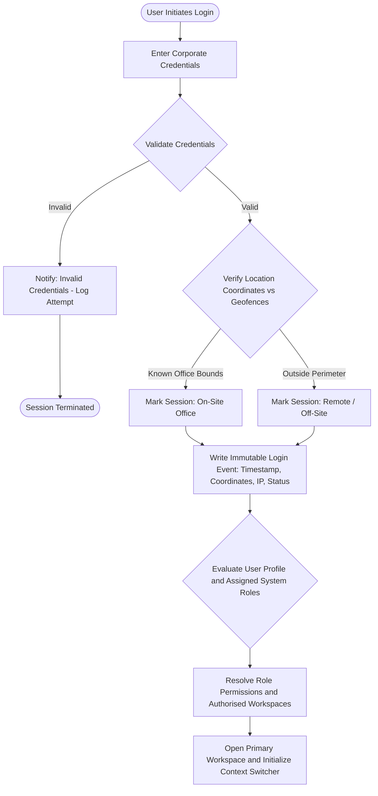
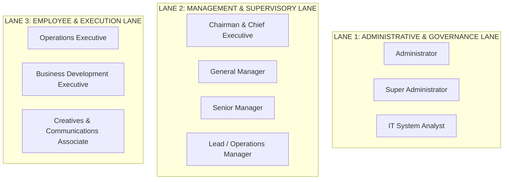
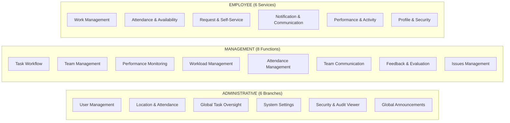
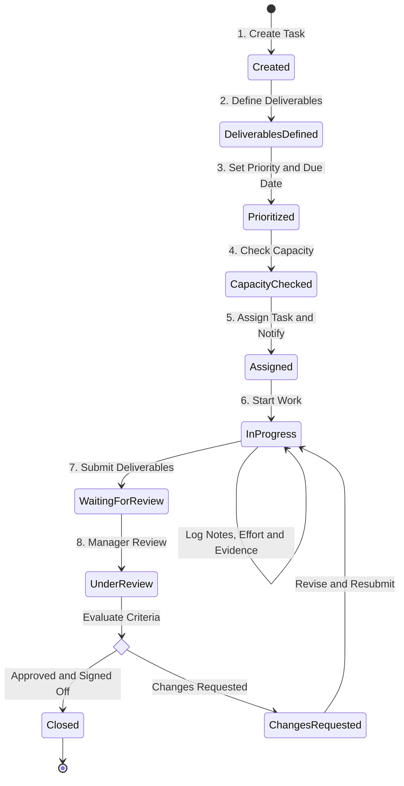
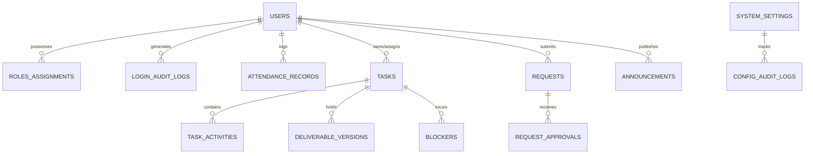
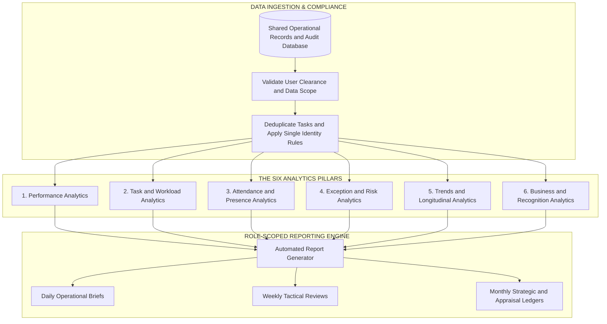
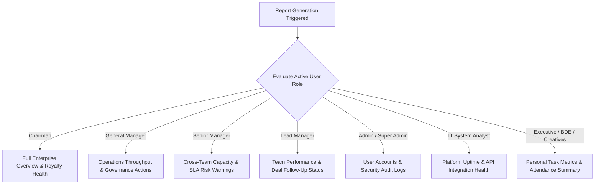
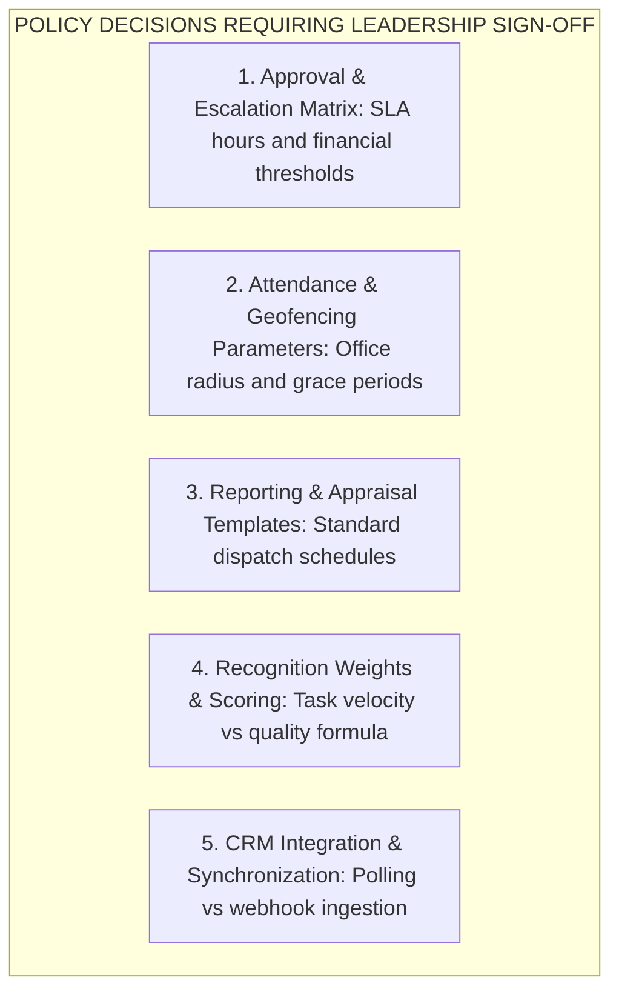

# CIRIL Internal Operations Tracking System (IOTS)
## Complete Operational Architecture & Systems Engineering Specification
### Master Stakeholder Reference Guide — Based on `gem_new_final-version.drawio`

---

## Document Control & Metadata

| Attribute | Specification |
| :--- | :--- |
| **System Name** | CIRIL Internal Operations Tracking System (IOTS) |
| **Document Purpose** | Comprehensive Architectural & Operational Stakeholder Specification |
| **Reference Architecture** | `gem_new_final-version.drawio` |
| **Classification** | Proprietary Enterprise Operational Specification |
| **Target Audience** | Executive Leadership, Department Managers, Operations Personnel, Technical Auditors |
| **Governance Standard** | Role-Based Access Control (RBAC), Append-Only Audit Ledger, Non-Destructive State Machine |

---

## 1. Executive Summary & System Vision

### 1.1 The Operational Mandate
The **CIRIL Internal Operations Tracking System (IOTS)** is an enterprise operations tracking and intelligence platform built to govern, track, and optimize all internal workflows across the corporate organization and its national brokerage network. 

Prior to IOTS, organizational work relied on disjointed spreadsheets, untracked communication channels, and fragmented status updates. Critical milestones—such as member office follow-ups, commercial brokerage royalty verifications (the standard **7.5% royalty pipeline**), multi-vertical market research publications, and creative asset approvals—lacked an auditable, deterministic lifecycle.

IOTS establishes an institutional backbone that unifies **10 discrete organizational roles** into a transparent, auditable, and performance-driven operating model.

```
┌────────────────────────────────────────────────────────────────────────────────────────┐
│                        CIRIL IOTS THREE-LAYER ARCHITECTURAL MODEL                      │
└───────────────────────────────────────────┬────────────────────────────────────────────┘
                                            │
 ┌──────────────────────────────────────────▼──────────────────────────────────────────┐
 │ LAYER 1: AUTHENTICATION, GEOLOCATION, SECURITY AUDIT & WORKSPACE ROUTING            │
 │ • Multi-Factor / Credential Validation  • Geofence Radius & Known vs Remote Flags  │
 │ • Immutable Login Event Logging         • Role Evaluation & Dynamic Workspace Load   │
 └──────────────────────────────────────────┬──────────────────────────────────────────┘
                                            │
 ┌──────────────────────────────────────────▼──────────────────────────────────────────┐
 │ LAYER 2: MANAGEMENT, OPERATIONS & UNIFIED WORK LIFECYCLE ENGINE                     │
 │ • 10 Discrete Role Workspaces Across 3 Functional Lanes (Admin, Management, Staff)  │
 │ • 8-Step Unified Task Lifecycle Engine (Create → Review → Corrections → Closure)     │
 │ • Decoupled Availability Engine (10 States) & Attendance Self-Service               │
 │ • Blocker Escalation Hierarchy & Non-Destructive Reassignment Transfers             │
 └──────────────────────────────────────────┬──────────────────────────────────────────┘
                                            │
 ┌──────────────────────────────────────────▼──────────────────────────────────────────┐
 │ SHARED OPERATIONAL RECORDS & APPEND-ONLY AUDIT DATABASE                             │
 │ • 8 Core Record Families               • Immutable Audit Contract                   │
 │ • Single Task Identity Invariant       • Loose Coupling to CRM Financial Truth      │
 └──────────────────────────────────────────┬──────────────────────────────────────────┘
                                            │
 ┌──────────────────────────────────────────▼──────────────────────────────────────────┐
 │ LAYER 3: INTELLIGENCE, ANALYTICS, REPORTING & RECOGNITION ENGINE                    │
 │ • 6 Analytics Pillars (Performance, Workload, Attendance, Risks, Trends, Business)  │
 │ • 3 Reporting Cadences (Daily Operational, Weekly Tactical, Monthly Strategic)      │
 │ • Role-Scoped Access Filters           • 3-Consecutive-Month Reward Architecture    │
 └─────────────────────────────────────────────────────────────────────────────────────┘
```

### 1.2 Core Architectural Invariants
1. **Work Activity ≠ Task State:** Task states (`Assigned`, `In Progress`, `Waiting for Review`, `Under Review`, `Closed`) are governed strictly by state transitions. Progress notes, file attachments, and time logs are historical activity events that never directly mutate the task state.
2. **Platform Privilege ≠ Business Authority:** Technical super-users (Super Administrator, IT System Analyst) hold comprehensive administrative and system diagnostics access, but cannot approve commercial terms, royalty distributions, leave requests, or creative deliverables without an explicit business mandate.
3. **Immutability & Non-Destructive Operations:** Reassigning a task transfers ownership without duplicating the task entity or destroying prior ownership history. Extending a deadline preserves the original target date for variance auditing.
4. **CRM Decoupling:** IOTS manages internal human coordination, accountability, and operational evidence. It reads CRM commercial deals and royalty milestones, but never mutates or overrides the CRM's primary financial ledger.

---

## 2. Layer 1: Authentication, Geolocation & Session Governance

Layer 1 serves as the secure gateway to the IOTS ecosystem, ensuring that every session is authenticated, location-verified, and bound to an immutable audit record before access to operational tools is granted.



### 2.1 Detailed Authentication Protocol
* **Single Sign-On & Account Integrity:** Users authenticate using company-issued credentials. Public self-registration is permanently disabled; all user accounts are provisioned exclusively through authorized administrative workflows.
* **Geofence Boundary Evaluation:** Upon credential verification, the system inspects the client's geographic coordinates against the approved corporate office coordinates and radius (e.g., Hyderabad Headquarters and authorized regional branches).
  * **On-Site Verification:** Sessions within the defined perimeter are tagged as `On-Site`.
  * **Remote / Off-Site Flagging:** Sessions originating outside approved geofences are flagged as `Remote / Off-Site`. This flag does not block access for mobile or remote staff, but enters the attendance tracking engine for manager auditing.
* **Session Audit Record:** An immutable audit entry is immediately written to the database capturing:
  ```text
  LoginEvent = { UserID, Timestamp, Latitude, Longitude, LocationStatus, IPAddress, UserAgent }
  ```
* **Role Decision & Workspace Dispatcher:** The system resolves the user's role assignments, pulls their active permission grants, loads their designated primary workspace, and initializes the global navigation context switcher.

---

## 3. The 3 Functional Lanes & 10 Dedicated Role Workspaces

IOTS partitions organizational responsibilities across **Three Functional Lanes** containing **Ten Specialized Role Workspaces**. Each workspace provides a tailored user interface, strict data filtering, and explicit operational tools.



### 3.1 Lane 1: Administrative & Governance Lane

#### 1. Administrator (Admin)
* **Core Function:** Routine day-to-day personnel administration and facility parameters.
* **Key Responsibilities:**
  * **Internal User Provisioning:** Manually creates internal employee profiles, assigns unique Employee IDs, allocates departments, specifies primary office locations, and binds reporting managers.
  * **Geofence Parameter Management:** Configures approved office GPS latitude/longitude coordinates and acceptable radius thresholds.
  * **Attendance & Location Auditing:** Reviews location exceptions, off-site attendance flags, and unexcused late arrivals.
  * **Global Task Monitoring:** Observes organizational task volumes to identify dormant or abandoned assignments requiring administrative cleanup.
  * **Company Announcements:** Drafts and dispatches targeted or company-wide administrative announcements.

#### 2. Super Administrator (Super Admin)
* **Core Function:** Macro-organizational governance, system policy, and compliance enforcement.
* **Key Responsibilities:**
  * **Organizational Architecture:** Manages company-wide department hierarchies, role definitions, and business domain boundaries.
  * **Permission & RBAC Governance:** Defines and tunes Role-Based Access Control matrices across all endpoints.
  * **High-Level Account Governance:** Authorizes critical credential changes, profile terminations, and account deactivations.
  * **Full Audit Oversight:** Holds unrestricted read access to immutable system audit logs and data access trails.
  * **Data Export Policy:** Governs compliance covenants, export authorizations, and data retention rules.

#### 3. IT System Analyst
* **Core Function:** Technical infrastructure observability, service health, and incident resolution.
* **Key Responsibilities:**
  * **Platform Health Monitoring:** Tracks application server uptime, database query latency, cache efficiency, and frontend response times.
  * **External API Integration Observability:** Monitors third-party service health, token expiration, and rate-limiting (e.g., geocoding services, SMTP relays, external storage).
  * **Security & Anomaly Detection:** Audits anomalous login velocity, impossible geographic location jumps, and session hijacking vectors.
  * **Incident Response & Bug Triage:** Manages technical incident tickets, resolves database deadlocks, and mitigates background worker failures.
  * **Deployment & Migration Tracking:** Catalogs application build deployments, environment configuration updates, and database schema migrations.
  * **Governance Guardrail:** Holds equal platform privilege with the Super Administrator, but possesses zero commercial approval authority (cannot approve commercial deal terms, royalty splits, or staff leave).

---

### 3.2 Lane 2: Management & Supervisory Lane

#### 4. Chairman & Chief Executive
* **Core Function:** Executive strategic intelligence, commercial health oversight, and institutional governance.
* **Key Responsibilities:**
  * **Macro Operational Intelligence:** Bird’s-eye visibility into enterprise throughput, organizational bottlenecks, and delivery milestones.
  * **Commercial Deal & 7.5% Royalty Oversight:** Real-time visibility into concluded national brokerage deals and verified collection of the firm's 7.5% royalty share.
  * **Company-Wide Attendance Health:** High-level dashboard tracking workforce presence, attendance compliance, and remote/unknown location trends.
  * **Executive "Requires Attention" Console:** Consolidated view of overdue task clusters, high-frequency reassignment loops, and unresolved cross-department blockers.
  * **Quarterly Recognition Sign-Off:** Reviews quarterly performance standings and personally signs off on prestigious **3-consecutive-month excellence commendations**.
  * **Enterprise Announcements:** Broadcasts high-priority strategic communications across all corporate dashboards.
  * **Appraisal Exports:** Generates comprehensive operational summaries formatted specifically for executive appraisals.
  * **Governance Boundary:** Does not perform routine administrative tasks (e.g., password resets or individual task reassignments).

#### 5. General Manager (GM)
* **Core Function:** Total day-to-day operational execution, executive Board coordination, and national network expansion.
* **Key Responsibilities:**
  * **Daily Operational Supervision:** Orchestrates cross-department operational workflows ensuring timely completion of enterprise initiatives.
  * **Board Coordination & Governance:** Prepares formal Board agendas, records Board meeting minutes, tracks resolution follow-ups, and archives governance records.
  * **Finance & Statutory Coordination:** Coordinates with internal accounting teams on invoice generation, operational expenses, vendor disbursements, and auditor compliance documentation.
  * **Conference & Event Leadership:** Plans and directs Annual and Zonal Conferences, managing hotel arrangements, vendor deliverables, member participation, and keynote schedules.
  * **Legal & Agreement Governance:** Liaises with legal counsel for drafting, reviewing, executing, and archiving Member Office Agreements, non-disclosure agreements (NDAs), and commercial contracts.
  * **Network Expansion:** Conducts prospective member discovery calls, delivers organizational value propositions, and accelerates brokerage network onboarding.
  * **Cross-Functional Escalation Resolution:** Acts as the central escalation authority for member office inquiries, operational friction, and inter-departmental dependencies.

#### 6. Senior Manager
* **Core Function:** Cross-department capacity balancing, SLA governance, and operational risk mitigation.
* **Key Responsibilities:**
  * **Cross-Team Workload Balancing:** Monitors real-time capacity and utilization across Operations, Business Development, and Creative teams to prevent burnout and bottlenecks.
  * **SLA & Deadline Risk Mitigation:** Proactively detects tasks at risk of breaching delivery deadlines and intervenes before client or member commitments are compromised.
  * **Managerial Escalation Queue:** Evaluates and resolves complex operational blockers escalated from Lead Managers.
  * **Comparative Performance Analysis:** Audits comparative team productivity, delivery efficiency, and quality benchmarks over time.

#### 7. Lead / Operations Manager
* **Core Function:** Direct operational supervision, brokerage deal tracking, client vertical management, and collateral fulfillment.
* **Key Responsibilities:**
  * **Member Deal & Royalty Tracking:** Interacts directly with regional member offices regarding concluded real estate transactions, following up on invoicing and the collection of the company's 7.5% royalty.
  * **Real Estate Vertical Management:** Manages and coordinates structured weekly calls across specialized asset verticals: **Retail**, **Logistics & Warehousing (L&W)**, **Land**, and **Hotels**.
  * **Direct Client Inquiries:** Handles high-value institutional client calls and property inquiries across all core asset verticals.
  * **Office Space Listing & Lead Distribution:** Manages listings on the corporate Office Space portal, captures inbound leads, routes them to respective member offices, and monitors conversion lifecycles.
  * **Quarterly Lead Exchange:** Compiles and organizes the quarterly lead exchange matrix, facilitating transaction flow between regional member offices.
  * **Quarterly Business Statistics:** Prepares comprehensive quarterly performance rankings, deal metrics, and member ratings for network-wide distribution.
  * **Conference & Collateral Coordination:** Coordinates with commercial printers and digital vendors for annual/zonal conference collateral (ID badges, banners, presentation binders) and quarterly market reports.
  * **Membership Dues & Agreement Operations:** Tracks member office agreement renewals and coordinates prompt collection of annual network membership dues.

---

### 3.3 Lane 3: Employee & Execution Lane

#### 8. Operations Executive
* **Core Function:** Distraction-free, high-fidelity execution of assigned operational deliverables.
* **Key Responsibilities:**
  * **Task Execution & Deliverable Submission:** Receives assigned tasks, reviews acceptance criteria, and submits structured deliverables within established deadlines.
  * **Effort & Progress Logging:** Records detailed progress notes, active effort durations, and operational evidence (documents, links, verification proofs).
  * **Linked Blocker Escalation:** Immediately flags operational bottlenecks, external dependencies, or resource deficits directly against the affected task record.
  * **Iterative Revision Cycles:** Incorporates supervisory review feedback, uploads amended deliverables, and tracks revision history.

#### 9. Business Development Executive (BDE)
* **Core Function:** Aggressive member network expansion, market prospecting, and commercial lead generation.
* **Key Responsibilities:**
  * **Broker Prospecting & Verification:** Researches and compiles verified commercial real estate broker profiles from RERA databases, trade directories, and web portals.
  * **Outreach Execution:** Conducts structured daily cold calling, personalized email outreach, and professional WhatsApp introductory campaigns to prospective member brokerages.
  * **Commercial Portal Management:** Actively monitors and operates commercial real estate portals (e.g., 99acres, Upturnly) for inbound commercial requirements.
  * **Pipeline & Follow-Up Management:** Maintains an exhaustive follow-up schedule, logging all interaction outcomes, objection contexts, and scheduling discovery calls for the General Manager.

#### 10. Creatives & Communications Associate
* **Core Function:** Multi-channel brand positioning, visual design production, research publication formatting, and corporate communications.
* **Key Responsibilities:**
  * **Multi-Channel Social Media Management:** Drives end-to-end social media campaigns across LinkedIn, Instagram, YouTube, and corporate channels.
  * **Quarterly Market Report Formatting & Proofreading:** Formats, designs, and rigorously proofreads quarterly real estate research reports, validating statistical charts and typographic standards.
  * **Visual Asset Production:** Designs institutional-grade graphics, marketing collateral, digital brochures, conference keynote decks, and identity badges.
  * **Strict Design Version Control:** Operates a rigorous design drafting pipeline with version-controlled iterations (`v1.0` → `v1.1` → `v2.0`).
  * **Office Vertical Call Support:** Coordinates zone-wise Office Vertical conference calls and assists in publishing client update summaries.

---

### 3.4 Multi-Role Capability & Workspace Context Switching
In dynamic corporate environments, staff members often execute cross-functional responsibilities (e.g., a creative specialist also acting as an operations executive for property vertical calls). IOTS handles this through an integrated **Multi-Role Context Switching Architecture**:

```
┌────────────────────────────────────────────────────────────────────────┐
│               UNIFIED MULTI-ROLE CONTEXT SWITCHING FLOW                │
└───────────────────────────────────┬────────────────────────────────────┘
                                    │
 1. UNIFIED AUTHENTICATION          ▼
    User logs in once with master corporate credentials.
──────────────────────────────────────────────────────────────────────────
 2. PROFILE CAPABILITY EVALUATION
    System identifies all authorized roles bound to the Employee ID:
    Example: [Role A: Creatives Associate] + [Role B: Operations Executive]
──────────────────────────────────────────────────────────────────────────
 3. PRIMARY WORKSPACE HYDRATION
    System loads the primary assigned workspace by default.
──────────────────────────────────────────────────────────────────────────
 4. ONE-CLICK CONTEXT SWITCHER (GLOBAL NAVIGATION BAR)
    User switches active role via the interface header.
    • Permissions, view scopes, and action buttons refresh dynamically.
──────────────────────────────────────────────────────────────────────────
 5. AUDIT & ACTION DISPATCH INVARIANT
    Every downstream database transaction writes an explicit compound identity:
    AuditRecord.Identity = EmployeeID + ActiveRole
    (Guarantees complete legal and operational non-repudiation).
```

---

## 4. Layer 2: Shared Operations Framework & Functional Matrix

Layer 2 provides the day-to-day functional interfaces for administrative management, supervisory controls, and employee self-service.



### 4.1 Detailed Functional Capabilities Matrix

| Functional Lane | Module / Branch | Detailed Capabilities & Workflow Actions |
| :--- | :--- | :--- |
| **Administrative Lane** | **User Management** | Create internal employee IDs; assign department, office location, reporting manager; configure active system roles; trigger secure password resets; execute account deactivations. |
| | **Location & Attendance** | Set authorized office GPS coordinates; define allowed geofence radii; configure shift hours and grace periods; audit remote/off-site check-ins; regularize attendance exceptions. |
| | **Global Task Oversight** | Monitor cross-department task volumes; inspect dormant or stranded assignments; reassign orphaned tasks; archive closed records. |
| | **System Settings** | Maintain role and designation master tables; set automated report distribution schedules; configure email and notification templates; adjust system parameters. |
| | **Security & Audit Viewer** | Inspect read-only audit trails; filter events by User, Role, Action Type, or Date; inspect authentication failures and suspicious session jumps; export audit reports. |
| | **Global Announcements** | Draft and publish official notices; target specific roles, departments, or entire organization; set publication and expiration schedules. |
| **Management Lane** | **Task Workflow** | Create tasks with defined deliverables; set priority and deadlines; check employee availability; assign tasks; review submissions; approve or return with feedback. |
| | **Team Management** | View team member assignments; monitor current queues; inspect historical performance; conduct 1-on-1 check-ins; track skill proficiencies. |
| | **Performance Monitoring** | Track on-time delivery rates; monitor completion ratios; identify overdue trends and revision patterns; evaluate output quality against targets. |
| | **Workload Management** | View real-time capacity and utilization across staff; identify overloaded or underutilized employees; balance task distribution across team members. |
| | **Attendance Management** | Supervise daily team attendance; review late arrivals and unplanned absences; evaluate leave, permission, and remote-work requests; approve or reject within mandate. |
| | **Team Communication** | Dispatch team-wide announcements; send targeted instructions on specific tasks; provide real-time guidance; maintain historical communication logs. |
| | **Feedback & Evaluation** | Conduct structured evaluations; document improvement action plans; provide detailed deliverable corrections; log commendations. |
| | **Issues Management** | Identify reported task blockers; assess severity and business impact; triage operational bottlenecks; route technical faults to IT Analyst; escalate to Senior/General Manager. |
| **Employee Lane** | **Work Management** | View personalized task queues sorted by priority; inspect acceptance criteria; log progress notes, active effort, and completion evidence; submit deliverables for review. |
| | **Attendance & Availability** | Daily check-in/check-out with automatic geolocation capture; set real-time availability status; track personal work hours and break intervals. |
| | **Request & Self-Service** | Submit formal requests for annual leave, medical leave, short permissions, remote work, or operational resources; track approval status and feedback. |
| | **Notification & Comms** | Receive immediate alerts for new task assignments, deadline reminders, review decisions, manager feedback, and corporate announcements. |
| | **Performance & Activity** | View personal task completion metrics, on-time delivery percentages, feedback history, and quarterly recognition eligibility standings. |
| | **Profile & Security** | View corporate profile and organizational details; update contact info; initiate secure password changes; review active login sessions. |

### 4.2 The Real-Time Availability Engine
IOTS decouples **Presence (Attendance)** from **Operational State (Availability)**. While attendance verifies that an employee is logged in and working, the Availability Engine communicates their real-time operational capacity through **10 Deterministic States**:

```text
Availability States:
• Available         • Busy              • In Meeting        • On Break
• In Training       • Do Not Disturb    • Working Remotely  • On Leave
• Absent            • Offline
```

* **Decoupled Architecture:** Setting an availability state (e.g., `In Meeting`) does not pause work hours or alter task deadlines; it informs supervisors and colleagues of immediate capacity.
* **Audit Trail:** Every availability transition is timestamped and recorded, providing visibility into daily operational patterns and focus time allocation.

---

## 5. The Unified Work Lifecycle State Machine

At the heart of IOTS is a deterministic, unified task lifecycle engine. Every operational assignment—whether a brokerage royalty follow-up, a corporate presentation design, or a member acquisition call—is executed through the **same standardized state machine**.



### 5.1 The 8-Step Lifecycle Breakdown

1. **Step 1: Task Creation**
   * The responsible manager initializes the task, establishing its operational objective and binding it to an internal project or business entity ID.
2. **Step 2: Deliverable Specification**
   * Explicit, measurable acceptance criteria are defined (e.g., "Signed 7.5% royalty reconciliation letter", "Finalized PDF market report v2.0", "Verified list of 25 RERA commercial brokers").
3. **Step 3: Priority & SLA Scheduling**
   * Priority is categorized (`Low`, `Medium`, `High`, `Urgent`). The baseline target completion timestamp is recorded:
     ```text
     BaselineDueDate = InitialScheduledDeadline (Immutable baseline timestamp)
     ```
     *Note: This baseline timestamp remains immutable across future extensions for variance auditing.*
4. **Step 4: Capacity & Availability Verification**
   * The manager reviews the target employee's current active queue, availability state, and pending deadlines to prevent overload.
5. **Step 5: Assignment & Dispatch**
   * State transitions to `Assigned / Pending`. An automated notification is pushed to the employee's dashboard, accompanied by deliverable criteria and due dates.
6. **Step 6: Active Execution**
   * The employee initiates work, transitioning state to `In Progress`. During execution, the employee regularly records:
     * Structured progress notes detailing milestones achieved.
     * Active effort duration logs (e.g., 2.5 hours).
     * Intermediate work drafts and verification artifacts.
7. **Step 7: Deliverable Submission**
   * The employee attaches final output proofs (documents, portal links, verified receipts) and clicks **Submit for Review**. State transitions to `Waiting for Review`.
8. **Step 8: Supervisory Review & Verification**
   * The manager inspects the submission under `Under Review`.
     * **Branch A (Approval):** If deliverables meet criteria, the manager signs off. State transitions to `Complete & Closed`. The completion timestamp, approving manager ID, and final evidence hash are permanently locked.
     * **Branch B (Changes Requested):** If corrections are necessary, the manager logs specific feedback. State transitions to `Changes Requested`. The employee is alerted, updates the work, and resubmits under a new version tag (preserving all prior revision notes).

---

### 5.2 Domain-Specific Pipeline Specializations
While all organizational work passes through the standardized 8-step lifecycle, three primary operational pipelines possess domain-specific business rules:

```mermaid
%%{init: {"themeVariables": {"fontSize": "18px"}, "flowchart": {"nodeSpacing": 36, "rankSpacing": 45}}}%%
flowchart TD
    subgraph Pipe1["1. MEMBERSHIP EXPANSION PIPELINE"]
        P1A["BDE Researches RERA and Directories"] --> P1B["Daily Cold Calls and WhatsApp Intro"]
        P1B --> P1C{"Prospect Interested?"}
        P1C -- "No" --> P1D["Archive / Future Follow-up Queue"]
        P1C -- "Yes" --> P1E["Schedule GM Discovery Meeting"]
        P1E --> P1F["GM Meeting and Value Proposition"]
        P1F --> P1G["Legal Drafts Agreement and Fee Invoice"]
        P1G --> P1H["Member Signs and Pays Annual Dues"]
        P1H --> P1I["Network Onboarding Complete"]
    end

    subgraph Pipe2["2. MEMBER DEAL & 7.5% ROYALTY PIPELINE"]
        P2A["CRM Lead Broadcast to Network"] --> P2B["Receiving Member Accepts Lead"]
        P2B --> P2C["Deal Negotiations and Property Inspection"]
        P2C --> P2D["Concluded Transaction Signed"]
        P2D --> P2E["Brokerage Invoice Raised"]
        P2E --> P2F["Calculate 7.5% Royalty on Giver and Receiver"]
        P2F --> P2G["Lead Manager Follows Up for Payment"]
        P2G --> P2H["Payment Confirmed and Verified in IOTS"]
    end

    subgraph Pipe3["3. CREATIVE & RESEARCH PIPELINE"]
        P3A["Executive Research Brief Received"] --> P3B["Data Extraction and Initial Draft v1.0"]
        P3B --> P3C["Design Layout and Typography in InDesign/Illustrator"]
        P3C --> P3D["Internal Proofreading and Copy Validation"]
        P3D --> P3E{"Editorial Corrections?"}
        P3E -- "Yes" --> P3F["Revise Layout and Copy v1.1"] --> P3D
        P3E -- "No" --> P3G["Manager Sign-Off and High-Res Export"]
        P3G --> P3H["Multi-Channel Publication and Distribution"]
    end
```



---

## 6. Exception Handling, Reassignment & Escalation Mechanics

In real-world operations, unexpected delays, resource constraints, and operational roadblocks occur. IOTS provides deterministic, transparent exception-handling workflows.

```mermaid
%%{init: {"themeVariables": {"fontSize": "18px"}, "flowchart": {"nodeSpacing": 36, "rankSpacing": 45}}}%%
flowchart TD
    subgraph OverdueFlow["OVERDUE WORKFLOW"]
        OD1["Task Passes Scheduled Due Date"] --> OD2{"Is Task Closed?"}
        OD2 -- "Yes" --> OD3(["Normal Completion"])
        OD2 -- "No" --> OD4["Automated System Flag: OVERDUE"]
        OD4 --> OD5["Alert Dispatched to Responsible Manager"]
        OD5 --> OD6{"Manager Intervention"}
        OD6 -- "Option A" --> OD7["Grant Extension: Record Justification"]
        OD6 -- "Option B" --> OD8["Reassign Task: Transfer Context and History"]
        OD6 -- "Option C" --> OD9["Escalate to Senior Manager"]
    end

    subgraph BlockerFlow["BLOCKER & ESCALATION WORKFLOW"]
        BK1["Employee Encounters Obstacle"] --> BK2["Raise Blocker on Task Record"]
        BK2 --> BK3["Specify Severity: Low / Med / High / Critical"]
        BK3 --> BK4["Alert Responsible Manager"]
        BK4 --> BK5{"Technical or Business Fault?"}
        BK5 -- "Technical Fault" --> BK6["Route to IT System Analyst"]
        BK5 -- "Business Dependency" --> BK7{"Resolvable within Authority?"}
        BK7 -- "Yes" --> BK8["Manager Resolves Blocker and Notifies"]
        BK7 -- "No" --> BK9["Escalate to Senior GM or Chairman"]
        BK8 --> BK10["Resume Task Execution"]
        BK9 --> BK10
        BK6 --> BK10
    end
```



### 6.1 Overdue Protocol & Deadline Extensions
* **Automated Overdue Flagging:** The moment system time surpasses `CurrentDueDate` and the task is not in `Closed` status, the system flags the task as `OVERDUE` and dispatches high-priority alerts to the task owner and supervising manager.
* **Audited Deadline Extensions:** A manager can grant a deadline extension only by providing an official operational justification. 
  ```text
  AuditTrail <- LogExtension(TaskID, BaselineDueDate, OldDueDate, NewDueDate, ManagerReason)
  ```
  *The original baseline due date is never overwritten, preserving full SLA variance visibility for Layer 3 reporting.*

### 6.2 Non-Destructive Task Reassignment
When workload balancing or employee absence requires transferring a task to a new owner:
1. **Single Identity Invariant:** The task preserves its unique primary key ID. No duplicate task records are created.
2. **Context Retention:** All previous progress notes, time logs, and attachment versions remain intact and accessible to the new owner.
3. **Audit Provenance:** An ownership transfer event is appended to the audit ledger:
   ```text
   TransferEvent = { TaskID, PreviousOwnerID, NewOwnerID, AuthorizingManagerID, TransferTimestamp, Reason }
   ```

### 6.3 Blockers & Escalation Hierarchy
* **Severity Taxonomy:** Blockers are tagged with explicit severity ratings:
  * `Low`: Minor delay, work continues on parallel deliverables.
  * `Medium`: Progress impeded; requires managerial input within 24 hours.
  * `High`: Milestone blocked; client or member SLA at immediate risk.
  * `Critical`: Complete organizational standstill or technical outage.
* **Separation of Fault Vectors:**
  * **Technical Faults:** System bugs, server latency, geocoding API errors, and mail delivery failures route automatically to the **IT System Analyst**.
  * **Commercial & Operational Blockers:** Client negotiation impasses, member royalty disputes, and inter-department dependencies route to the **Responsible Manager**, escalating to the **Senior Manager** or **General Manager** if unresolved within established SLA thresholds.

---

## 7. Shared Operational Records & Append-Only Audit Database

Underpinning the entire IOTS architecture is the **Shared Operational Records & Audit Database**. It serves as the single source of truth for all organizational activity, ensuring absolute transparency and non-repudiation.



### 7.1 The Append-Only Audit Contract
Every write operation across the system must satisfy the **IOTS Audit Contract**. Direct database record deletions or unrecorded mutations are strictly prevented at the database schema and ORM levels.

```text
AuditEvent Structure:
  • Timestamp:       ISO 8601 Microsecond Timestamp
  • EmployeeID:      Unique User Identifier
  • ActiveRole:      Role Context Active at Action Time
  • ActionType:      CREATE | UPDATE | DELETE | APPROVE | REASSIGN | ESCALATE
  • TargetEntity:    Table / Entity Name and Primary Key ID
  • BeforeValue:     JSON Snapshot of State Before Mutation
  • AfterValue:      JSON Snapshot of State After Mutation
  • ReasonNote:      Mandatory Explanation for Critical Actions
  • SourceVector:    Client IP, User Agent, API Origin
```

### 7.2 The 8 Stored Record Families
1. **User & Identity Records:** Employee profiles, department allocations, role assignments, reporting lines, credential update histories.
2. **Task & Lifecycle Records:** Tasks, acceptance criteria, scheduled deadlines, priority tiers, current lifecycle states.
3. **Activity & Evidence Records:** Chronological progress notes, active effort logs, uploaded deliverable files, evidence hashes, review feedback notes.
4. **Attendance & Presence Records:** Daily check-in/out timestamps, GPS coordinates, geofence status flags, break intervals, total calculated hours.
5. **Requests & Self-Service Records:** Leave applications, permission slips, remote work requests, resource requisitions, manager decision logs.
6. **Blockers & Incident Records:** Blocker tickets, severity ratings, business impact analyses, resolution notes, technical incident logs.
7. **Communications & Announcements:** Broadcast announcements, targeted role bulletins, team messages, publication and expiration timestamps.
8. **System Configuration & Security:** Geofence parameters, shift definitions, metric targets, permission matrices, API integration tokens.

---

## 8. Layer 3: Operational Intelligence, Analytics, Reporting & Recognition

Layer 3 transforms the raw, timestamped operational data captured in Layer 2 into real-time business intelligence, automated executive reports, and performance recognition standings.



### 8.1 The Six Pillars of Operational Analytics

#### 1. Performance Analytics
* **True Completion Ratio:** Measures task closures against total assigned workload over a defined period:
  ```text
  Completion Rate (%) = (Tasks Completed Successfully / Total Assigned Workload) * 100
  ```
  *(Mathematical Rule: If denominator is 0, metric evaluates to `N/A`, avoiding division-by-zero errors).*
* **On-Time Delivery Index:** Percentage of tasks closed on or before the baseline scheduled deadline versus late closures.
* **Effort vs. Elapsed Ratio:** Compares total active working effort logged against gross calendar elapsed duration, exposing idle wait periods.

#### 2. Task & Workload Analytics
* **Queue Distribution:** Real-time visibility into active task volumes across states: `Assigned`, `In Progress`, `Waiting for Review`, `Under Review`.
* **Team Capacity Balance:** Highlights disparities where specific team members carry disproportionate task weights relative to peers.
* **Backlog Aging:** Analyzes aging curves of unfinished tasks to prevent dormant backlog accumulation.

#### 3. Attendance & Presence Analytics
* **Punctuality & Grace Analysis:** Tracks arrival times against shift parameters and permissible grace windows.
* **Absence Classification:** Distinguishes formally approved leaves from unexplained absences.
* **Geofence Compliance:** Calculates the ratio of on-site office sessions versus remote/off-site check-ins.

#### 4. Exception & Risk Analytics
* **Overdue Clustering:** Flags teams or projects accumulating high volumes of overdue assignments.
* **Reassignment Velocity:** Identifies tasks undergoing multiple ownership transfers, signaling ambiguous deliverables or skill mismatches.
* **Blocker Severity Index:** Combines blocker duration, severity rating, and commercial impact to generate a composite project risk score.

#### 5. Trends & Longitudinal Analytics
* **Periodic Delta Tracking:** Compares performance metrics across standard chronological intervals:
  ```text
  Periodic Variance Formulas:
    • Day Variance:   Today vs Yesterday
    • Week Variance:  Current Week vs Prior Week
    • Month Variance: Current Month vs Prior Month
  ```
* **Workload Velocity Trends:** Forecasts milestone delivery trajectories based on historical completion speeds.

#### 6. Business & Commercial Analytics
* **7.5% Royalty Follow-Up Health:** Tracks commercial real estate deal completions reported in the network, monitoring the status of fee collections and outstanding royalty balances owed to the firm.
* **Membership Acquisition Pipeline:** Measures prospective broker outreach volume, conversion rates, and annual fee settlement velocity.
* **Marketing & Research Cadence:** Tracks quarterly market research report publication milestones and social media campaign velocity.

---

### 8.2 Role-Scoped Reporting Hierarchy

To enforce data privacy, prevent unauthorized disclosure, and deliver relevant context, all reports are filtered through a strict **Role-Scoped Recipient Filter**:



### 8.3 The Gamified Recognition & Reward Architecture
To drive employee motivation and institutional excellence, IOTS incorporates an objective, data-backed **Recognition & Reward Engine**. Rather than relying on subjective evaluations, recognition is derived directly from verified operational records.

```
┌────────────────────────────────────────────────────────────────────────┐
│             THREE-CONSECUTIVE-MONTH RECOGNITION ARCHITECTURE           │
└───────────────────────────────────┬────────────────────────────────────┘
                                    │
 1. MONTHLY EVIDENCE EVALUATION     ▼
    System aggregates verified operational achievements across the month:
    • On-time task completion rate ≥ 95%
    • Zero unexplained attendance exceptions
    • High deliverable quality score (minimal review revisions)
    • Role-specific targets achieved (e.g., outreach volume, report delivery)
──────────────────────────────────────────────────────────────────────────
 2. QUALIFYING MONTH BADGE AWARDED
    Employee achieves "Monthly Operational Excellence" standing.
──────────────────────────────────────────────────────────────────────────
 3. THE THREE-CONSECUTIVE-MONTH INVARIANT
    To qualify for formal Corporate Awards and financial commendations,
    an employee must achieve qualifying standing for:
    3 CONSECUTIVE MONTHS (Month 1 → Month 2 → Month 3)
    (A single broken month resets the qualification counter).
──────────────────────────────────────────────────────────────────────────
 4. EXECUTIVE SIGN-OFF & ANNOUNCEMENT
    • System compiles verified 90-day appraisal dossier.
    • The Chairman personally reviews the dossier and signs off.
    • Enterprise announcement published across all corporate dashboards.
```

---

## 9. Implementation Roadmap & Leadership Policy Sign-Offs

While the architectural blueprint in `gem_new_final-version.drawio` is technically complete, several **business policy decisions** require formal corporate leadership determination prior to database seed deployment:



### Policy Sign-Off Checklist for Corporate Leadership
- [ ] **Policy 1 (Escalation Thresholds):** Define exact SLA elapsed hours for Task Inactivity (e.g., 48 hours) and High-Severity Blockers (e.g., 4 hours) prior to automated managerial escalation.
- [ ] **Policy 2 (Attendance & Grace Limits):** Confirm standard office check-in window (e.g., 09:30), maximum grace duration (e.g., 15 minutes), and monthly allowable late-arrival instances before formal HR flagging.
- [ ] **Policy 3 (Appraisal Export Layout):** Review and freeze the executive appraisal template layout generated by Layer 3 for annual compensation and promotion reviews.
- [ ] **Policy 4 (Reward Weightings):** Approve the numerical formula weighting on-time task completion (40%), deliverable quality (30%), and role-specific KPI targets (30%) for the 3-consecutive-month excellence award.
- [ ] **Policy 5 (CRM Data Ingestion SLA):** Ratify the protocol for synchronizing concluded CRM brokerage deals and 7.5% royalty status milestones into the IOTS operational follow-up queue.

---

## 10. Summary & Stakeholder Takeaway

The CIRIL Internal Operations Tracking System (IOTS) is an **enterprise operational operating system**. By establishing clean boundaries between administrative governance, managerial supervision, and employee execution, IOTS delivers:

1. **Complete Operational Clarity:** Every employee knows their exact priorities, acceptance criteria, and deadlines.
2. **Deterministic Accountability:** All tasks, reviews, exceptions, and reassignments follow an immutable, auditable state machine.
3. **Executive Visibility:** Leadership maintains real-time oversight of national deal flow, royalty collection health, and workforce productivity.
4. **Data-Driven Motivation:** Objective operational metrics feed an auditable, multi-tier recognition framework that rewards sustained excellence.

---
*End of Specification — CIRIL Internal Operations Tracking System (IOTS)*
