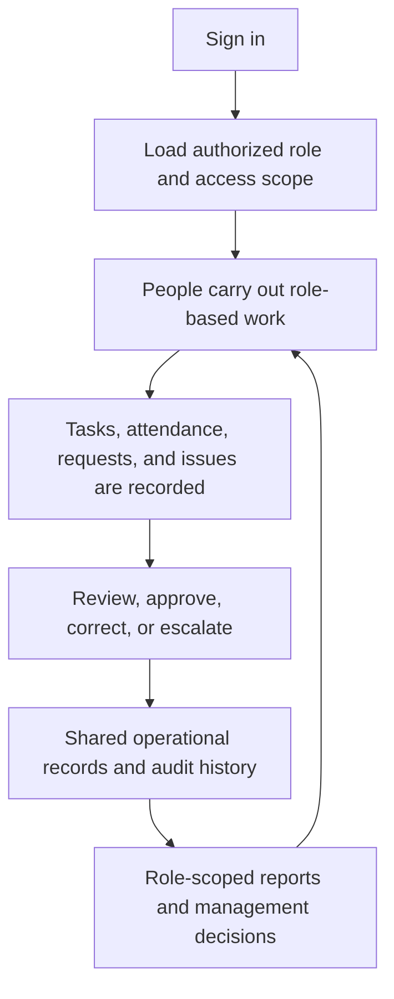

# CIRIL Internal Operations Tracking System
## Stakeholder Reference

**Purpose:** This document explains the proposed system in plain language for leadership and operational stakeholders. It summarizes the detailed design in `detailed_documentation_gem.md` and `gem_new_final-version.drawio`. It describes the intended operating model; it does not claim that every capability has already been implemented.

## At a glance

The system is designed to connect authorized people, day-to-day work, exception handling, and management reporting through a shared, traceable record of activity.

## Who does what

The design groups ten role workspaces into three functional areas. A person may hold more than one role under one employee identity.

| Area | Main responsibilities |
| --- | --- |
| Administration | Maintain employee accounts, roles, access, attendance settings, announcements, and administrative records. |
| Management | Plan and assign work, review submissions, balance workload, decide requests within delegated authority, and address issues or escalations. The Chairman receives enterprise-level information and handles designated strategic decisions. |
| Employees and specialists | Complete assigned work and record progress and supporting evidence. This group includes Executives, Business Development Executives, and Creative Communications Associates, each with role-specific work. |

Super Admin and IT System Analyst roles support platform governance and technical operations. Their technical access does not by itself grant authority to approve business matters; approvals follow the organization’s configured mandate.

## How work moves

1. **Access:** The system checks sign-in credentials, records relevant session and location information, and opens the user’s assigned role workspace and data scope.
2. **Assignment:** A manager defines the purpose, expected deliverables, priority, due date, owner, and reviewer, taking capacity and availability into account.
3. **Execution:** The employee works on the task and records progress, notes, effort or time, and evidence. These activity records provide history; they do not silently change the task’s formal status.
4. **Review:** The employee submits the deliverable. The manager reviews it against the expected outcome and either approves it or requests changes.
5. **Closure or correction:** Approved work is closed with its decision and final evidence recorded. If changes are requested, the employee revises and resubmits while previous versions and feedback remain available.

## When something changes or goes wrong

- **Overdue work:** The responsible manager reviews the impact and context, then decides whether to extend the deadline, reassign the work, or escalate it. The original deadline and ownership history remain visible.
- **Blockers and issues:** The employee can raise an issue with its severity, impact, and evidence. A manager addresses it within their authority or escalates it to a designated leader or specialist. The issue remains open until resolution is checked; unresolved items retain a follow-up owner and review date.
- **Requests and attendance exceptions:** Employees can submit leave, permission, scheduled remote work, resource requests, or attendance corrections. An authorized reviewer checks the dates, explanation, and evidence, then approves, rejects, or returns the request for more detail. The employee is notified and the decision is recorded.
- **Reassignment:** A transfer changes task ownership without creating a duplicate task. The reason, affected people, and prior owner remain traceable.

## Records and management information

Operational actions feed shared records for users and roles, tasks and activity, deliverables and evidence, attendance and availability, requests and decisions, issues and escalations, communications, and system events.

The audit history is intended to identify who acted, in which role, when, on what record, what changed, and why. Reports should preserve access limits and link summary measures back to their source records.

Authorized users can receive views of:

- task completion, timeliness, review queues, and workload;
- attendance, approved leave, availability, and incomplete records;
- overdue work, repeated reassignment, unresolved blockers, and other configured risks;
- trends over daily, weekly, and monthly periods; and
- relevant business follow-ups, such as membership activity and CRM-linked deal or royalty status.

Reports are scoped to the recipient’s role and responsibilities. Managers use them to follow up on work and exceptions; leadership uses higher-level summaries to make organizational decisions. A metric or risk flag informs a decision but does not replace the authorized person’s judgment.

## Decisions still needed

Before operational rules are finalized, leadership should confirm the approval and escalation mandates, attendance and location settings, report schedules and templates, recognition criteria, and CRM data synchronization rules. Financial status should continue to rely on verified CRM source records; the tracking system records internal follow-up and accountability.

## Stakeholder takeaway

The proposed system gives staff a shared way to receive work, record what happened, resolve exceptions, and preserve decisions. It gives management a traceable view from an organization-level report down to the task, request, evidence, and decision behind it. Its value depends on clear approval authority, agreed policies, accurate source data, and reports that match each role’s access.