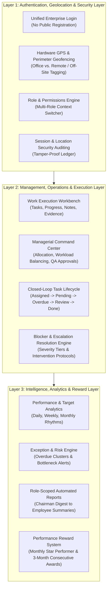

# CIRIL Internal Operations Tracking System (IOTS)
## Master Enterprise System Encyclopedia & Operational Blueprint

> **System Name:** CIRIL Internal Operations Tracking System (IOTS)  
> **Platform Version:** 2.0 Enterprise Release  
> **Organization:** Commercial Real Estate Institutional Alliance (CIRIL)  
> **Target Audience:** Executive Leadership, Operational Managers, Execution Teams, System Administrators, and Auditors  
> **Document Status:** Comprehensive Enterprise Specification (Zero-Jargon, Layman-Accessible Edition)  
> **Repository Location:** `iots-app/documentation/worker/`

---

## 1. Executive Introduction & The Layman's Perspective

### What is the Internal Operations Tracking System (IOTS)?
Think of a large, high-performing corporate hospital or an international airport flight operations center. In such organizations, success depends on dozens of people doing precise jobs at the exact right moment:
- Planes must be fueled, baggage loaded, flight paths verified, passengers boarded, and runways cleared.
- If the baggage handlers are delayed, the pilot cannot take off. If the air traffic controller does not know who is at which gate, chaos ensues.
- The Airport Director does not load bags or steer planes, but needs an executive radar screen showing every flight, any safety delays, and on-time performance across all terminals.

**The CIRIL Internal Operations Tracking System (IOTS)** is that exact flight operations control center, built specifically for **CIRIL**—India’s premier commercial real estate alliance network. 

CIRIL brings together certified commercial real estate advisory firms across major metropolitan zones (North, South, East, West, Central). Corporate clients (like major multinational IT companies, banks, and retail giants) need commercial offices, warehouses, and land across different cities. When a client in Mumbai needs a 50,000 sq ft office in Bengaluru:
1. The Mumbai team originates the requirement (acting as the **Lead Giver**).
2. CIRIL Headquarters coordinates and handshakes the requirement to the vetted Bengaluru team (acting as the **Lead Receiver**).
3. The Bengaluru team inspects properties, prepares institutional proposals, and closes the lease.
4. Upon closing, brokerage fees are collected and split (30% to Lead Giver, 70% to Lead Receiver), and CIRIL receives its **7.5% corporate royalty**.

To keep this nationwide commercial machinery operating smoothly, CIRIL requires an **Internal Operations Tracking System (IOTS)**. The system guarantees that:
- Every employee knows exactly what task they need to do today, when it is due, and what materials they need.
- Every manager knows who is working, who is overloaded, who is on leave, and which tasks are falling behind before deadlines are missed.
- The Chairman and Executive Leadership have complete 360-degree radar visibility over daily operational health, team output, location integrity, financial milestones, and outstanding exceptions.
- Outstanding employee dedication is tracked objectively and rewarded transparently through monthly and quarterly excellence recognitions.

---

## 2. The 3-Layer Enterprise Architecture

The entire IOTS platform is structured into three foundational layers that work in complete harmony:



### Layer 1: Authentication, Geolocation & Security Layer
- **No Self-Registration:** Accounts are securely provisioned by authorized administrators.
- **Unified Login Door:** Everyone logs in through the same corporate portal. The system automatically inspects credentials, verifies the physical GPS location against authorized office boundaries, records an immutable audit log, and launches the user into their customized workspace.
- **Multi-Role Capability:** If an individual wears multiple hats (e.g., managing operations while executing key vertical calls), the system provides an instant **Workspace Context Switcher** without requiring repeated logins.
- **Friendly Geolocation Transparency:** If an employee logs in from home, a client site, or outside the office perimeter, the system does not display an alarming error. Instead, it tags the session transparently as **"Remote / Off-Site"**, updates the manager, and logs the event for location auditing.

### Layer 2: Management, Operations & Execution Layer
- **Separation of Management & Execution:** Managers allocate work, balance workloads, review submissions, and resolve blockers. Execution staff focus on delivering tasks with high quality, updating progress, logging work activity, and uploading deliverables.
- **11 Role-Tailored Dashboards:** From the Chairman's high-level radar to the Graphic Designer's creative version workbench, every role operates with dedicated tools while sharing a unified design language.
- **Closed-Loop Task Lifecycle:** Tasks are never lost. If a task becomes overdue, the system triggers active manager intervention (deadline extension, reassignment, or guidance) rather than letting work stagnate.
- **Constructive Correction Cycles:** If a manager rejects a submission, the task enters a structured revision cycle with clear feedback, preserving all previous versions and comments.

### Layer 3: Intelligence, Analytics & Reward Layer
- **Actionable Business Intelligence:** Dashboards eliminate vanity metrics. Every graph answers a vital operational question: *Where are bottlenecks forming? Is any team member facing burnout? Are commercial proposals being delivered on schedule?*
- **Predictive Risk Alerts:** Highlights early warning signals before a missed deadline or client escalation occurs.
- **Automated Reporting Engines:** Generates scheduled daily operational digests, weekly team scorecards, and monthly executive summaries automatically.
- **Objective Reward & Recognition System:** Automatically measures performance against clear criteria (task completion rates, on-time SLA achievement, attendance consistency, and low revision rates), rewarding monthly excellence and honoring three-consecutive-month high performers with prestigious quarterly company awards.

---

## 3. The 11 Organizational Roles at a Glance

The IOTS platform defines **11 distinct operational roles**, ensuring complete clarity of ownership across the organization:

| Role # | Role Title | Primary Organizational Scope | Key Responsibilities | Access Band |
| :---: | :--- | :--- | :--- | :--- |
| **1** | **Chairman** | Apex Executive Oversight | Enterprise operational health, commercial pulse, critical escalations, strategic interventions, and company-wide audit review. | Higher-Level Access (Executive Cockpit) |
| **2** | **Super Admin** | Platform Governance & Security | Master configuration, organization vertical structures, security compliance, platform audit logs, and system data authority. | Full System Authority (Co-Equal with IT Analyst) |
| **3** | **Admin** | Routine Organizational Administration | User onboarding/provisioning, office geofence perimeters, attendance audit, global task monitoring, and corporate announcements. | Higher-Level Access (Administrative) |
| **4** | **IT System Analyst** | Technical Reliability & Infrastructure | Service & API uptime monitoring, database health, authentication anomaly detection, technical incident resolution, and change logs. | Full System Authority (Co-Equal with Super Admin) |
| **5** | **General Manager** | Cross-Department Operations & Governance | Strategic operational management, Board of Directors coordination, finance & accounts alignment, legal coordination, and expansion oversight. | Higher-Level Access (Executive Managerial) |
| **6** | **Senior Manager** | Multi-Team Supervision & SLA Delivery | Cross-team workload balancing, manager escalation review, inter-team dispute resolution, senior approval queues, and SLA risk mitigation. | Higher-Level Access (Multi-Team Operations) |
| **7** | **Lead Manager** | Day-to-Day Team Command & Execution | Direct team task assignment, live availability tracking, capacity-based workload balancing, overdue task intervention, QA reviews, and leave approvals. | Higher-Level Access (Team Command) |
| **8** | **Executive** | Core Operations & Task Delivery | Routine operational task execution, daily progress updates, work notes, file attachments, blocker reporting, and resubmissions. | Limited Access (Execution Workbench) |
| **9** | **Business Development Executive (BDE)** | Network & Membership Expansion | Cold outreach, prospective member prospecting (RERA, 99acres), lead follow-ups, WhatsApp/email campaigns, and target quota execution. | Limited Access (BD Workbench) |
| **10** | **Social Media Manager** | Brand Campaigns & Digital Engagement | Content pipeline coordination (drafting to publishing), content calendar scheduling, multi-platform releases, and creative asset requests. | Limited Access (Content Workbench) |
| **11** | **Graphic Designer** | Creative Collaterals & Institutional Assets | Creative brief execution, version-controlled design management (v1, v2, v3), presentation decks, conference print collaterals, and report layouts. | Limited Access (Creative Workbench) |

---

## 4. Documentation Suite Roadmap & Sitemap

To provide exhaustive, enterprise-grade clarity, this encyclopedia is organized into seven specialized reference manuals:

```
iots-app/documentation/worker/
│
├── 00_IOTS_ENTERPRISE_SYSTEM_ENCYCLOPEDIA_INDEX.md  (This Master Document)
│
├── 01_ORGANIZATIONAL_ROLES_AND_RESPONSIBILITIES_MATRIX.md
│   └── Deep-dive into all 11 roles, CIRIL staff mappings (Ipsheeta, Manasa, Bhavani, Harshitha),
│       multi-role switching, data scope, permitted actions, and authority guardrails.
│
├── 02_TASK_LIFECYCLE_EXECUTION_AND_WORKFLOW_ENGINE.md
│   └── Step-by-step task flow, 5 reporting states, 7 micro-states, overdue intervention,
│       reassignment protocol, QA review cycle, work activity recording, and immutable audit logs.
│
├── 03_ATTENDANCE_GEOLOCATION_AND_SECURITY_AUDITING.md
│   └── Check-in/check-out mechanics, live availability states, GPS geofencing, remote/off-site
│       session auditing, location anomaly flags, and Chairman security oversight.
│
├── 04_CIRIL_COMMERCIAL_OPERATIONS_AND_REVENUE_INTEGRATION.md
│   └── Zoned member alliance model, 6-phase deal lifecycle, 30/70 LG vs LR splits, 7.5% royalty
│       calculation, research intelligence engine, conference operations, and listing portal links.
│
├── 05_INTELLIGENCE_ANALYTICS_AND_AUTOMATED_REPORTING.md
│   └── Daily, weekly, monthly reporting rhythms, 6 analytical modules, risk classification
│       (Low/Med/High), predictive early-warning signals, and automated scheduled distribution.
│
├── 06_EMPLOYEE_PERFORMANCE_REWARD_AND_RECOGNITION_SYSTEM.md
│   └── Objective monthly scorecards, 3-consecutive-month excellence criteria, star performer
│       badges, spot bonuses, Chairman commendations, and transparent gamification mechanics.
│
└── 07_ENTERPRISE_UI_UX_DESIGN_SYSTEM_AND_DASHBOARD_BLUEPRINTS.md
    └── Desktop-first 1440px 12-column grid, unified shell, semantic color tokens, and complete
        screen blueprints for all 11 role dashboards and reusable workspace components.
```

---

## 5. Core System Principles & Operational Guardrails

1. **Complex Underneath, Simple on Top:**  
   The underlying data model tracks sub-meter GPS coordinates, micro-second audit events, and intricate revenue splits. However, the user interface remains clean, calm, and self-explanatory. Users are never subjected to confusing error codes or cluttered screens.

2. **Zero Passive Task Drift:**  
   A task can never simply "expire" into oblivion. When a deadline passes, the system immediately demands manager review and structured resolution. Accountability is active and continuous.

3. **Immutable Accountability (Audit by Design):**  
   Every major operational action—from reassigning a task to modifying an office perimeter or granting leave—writes an indelible entry into the audit trail. Audit logs cannot be altered or deleted by any user, including administrators.

4. **Equity and Transparency:**  
   Performance is evaluated using verifiable operational metrics rather than subjective opinions. Every employee can view their own scorecards, task progress, and reward eligibility in real time.

5. **Security with Dignity:**  
   Location verification exists to protect corporate integrity and confirm workplace safety, not to act as punitive surveillance. Remote and off-site work is seamlessly accommodated with transparent tagging and manager visibility.

---

> Proceed to [**`01_ORGANIZATIONAL_ROLES_AND_RESPONSIBILITIES_MATRIX.md`**](./01_ORGANIZATIONAL_ROLES_AND_RESPONSIBILITIES_MATRIX.md) for the complete breakdown of organizational roles, operational responsibilities, and access boundaries.
