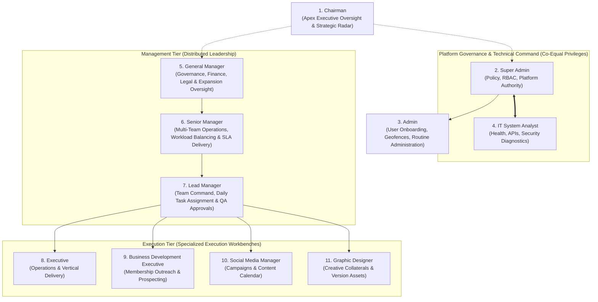

# CIRIL Internal Operations Tracking System (IOTS)
## Chapter 1: Organizational Roles, Responsibilities & Access Governance

> **Document Code:** `IOTS-DOC-01`  
> **Target Audience:** All Personnel, Department Heads, System Administrators, and HR Leadership  
> **Context:** Deconstruction of CIRIL's 11 Institutional Roles, Transition from Single Manager to Distributed Hierarchy, and Real Staff Mappings

---

## 1. The Operational Transformation: From Monolith to Distributed Excellence

In earlier operations, CIRIL relied on a heavily centralized managerial bottleneck where a single General Manager / Operations Lead was expected to oversee everything:
- Coordinating board meetings and minute-taking
- Chasing member brokerages for deal closures and 7.5% royalty remittances
- Running cold calls and member expansion outreach
- Overseeing social media posts and graphic design proofreading
- Calling vendors for conference stationery and report printing
- Managing day-to-day employee leaves, attendance, and task status

This bottleneck created severe operational risks: single points of failure, delayed task reviews, employee burnout, and limited real-time visibility for the Chairman.

The **Internal Operations Tracking System (IOTS)** redesigns CIRIL’s operational hierarchy into **11 clearly bounded roles**. It establishes a clear operational chain of command where:
1. Executive strategy is held by the **Chairman**.
2. Platform integrity and technical diagnostics are safeguarded by **Super Admin** and the **IT System Analyst** (both possessing equal system-level privileges).
3. Routine organizational housekeeping is managed by the **Admin**.
4. Management is distributed across three focused tiers: **General Manager**, **Senior Manager**, and **Lead Manager**.
5. Execution is handled by dedicated specialists: **Executive**, **Business Development Executive (BDE)**, **Social Media Manager**, and **Graphic Designer**.

---

## 2. Institutional Hierarchy & Organizational Chain of Command



---

## 3. Exhaustive Role Breakdown & CIRIL Staff Mapping

### Role 1: Chairman
- **Layman's Analogy:** The Captain on the bridge of a naval ship. The Captain does not grease the engines or peel vegetables, but continuously watches the global radar, verifies heading and fuel, and steps in when high-risk hazards appear.
- **Operational Scope:** Entire Enterprise (National Headquarters, All Geographic Zones, All Functional Departments).
- **Real CIRIL Function:**
  - Receives complete bird's-eye operational intelligence across the entire alliance.
  - Monitors high-level commercial deal flow and royalty collections (ensuring CIRIL’s 7.5% royalty health).
  - Inspects company-wide attendance and location audit summaries, specifically tracking remote/unknown location trends.
  - Reviews the **Executive "Requires Attention" Cockpit**: overdue task clusters, repeated task reassignments, and unresolved departmental blockers.
  - Reviews the **Quarterly Reward & Recognition Standings** to personally sign off on the 3-consecutive-month excellence commendations.
- **Permitted Actions:**
  - View all organizational metrics, departments, teams, tasks, and audit logs.
  - Issue high-priority executive directives or escalations (requires secondary confirmation).
  - Publish enterprise-wide Chairman Announcements.
- **Forbidden Actions:**
  - Cannot reset routine employee passwords (delegated to Admin).
  - Cannot perform everyday task reassignment or micro-manage task checklists.

---

### Role 2: Super Admin
- **Layman's Analogy:** The Chief Architect and Master Key Holder of a skyscraper. They configure the master security doors, define who can enter which floor, and oversee system safety.
- **Operational Scope:** System-Wide Platform Architecture.
- **System Parity Note:** **Super Admin and IT System Analyst have equal platform privileges.** The Super Admin focuses on administrative governance, while the IT Analyst focuses on technical infrastructure.
- **Key Responsibilities:**
  - Manages master organizational configurations, department definitions, and role definitions.
  - Configures Role-Based Access Control (RBAC) permission sets.
  - Holds authority to deactivate or alter high-level accounts.
  - Inspects full, immutable system audit logs.
  - Manages data export covenants and compliance frameworks.
- **Permitted Actions:**
  - Full read/write/configure access across all database tables, user records, and operational settings.
  - Grant or revoke user roles and multi-role assignments.
  - Define custom geofence boundaries for official offices.

---

### Role 3: Admin
- **Layman's Analogy:** The Facility Operations Manager of a corporate campus. They issue employee ID cards, set office opening hours, maintain the company directory, and announce building updates.
- **Operational Scope:** Routine Organizational Administration & Operations Support.
- **Key Responsibilities:**
  - **Structured User Provisioning:** Manually creates internal user profiles (Employee ID, Designation, Department, Office Location, System Role, Reporting Manager). *There is no public registration.*
  - **Location & Geofence Perimeter Management:** Configures approved office GPS coordinates and allowable radius boundaries (e.g., 100 meters).
  - **Attendance Auditing:** Reviews location exceptions, off-site attendance flags, and unexcused late arrivals.
  - **Global Task Oversight:** Monitors organizational work queues to identify abandoned tasks or perform archival cleanups.
  - **Company Announcements:** Drafts and publishes official communications to specific teams or the entire organization.
- **Permitted Actions:**
  - Create and edit user profiles, activate/deactivate accounts, trigger password recovery workflows.
  - Manage office location boundaries and view location audit logs.
  - Archive completed operational records upon administrative approval.
- **Forbidden Actions:**
  - Cannot alter core code, platform security schemas, or system API connections (restricted to Super Admin & IT Analyst).

---

### Role 4: IT System Analyst
- **Layman's Analogy:** The Chief Flight Engineer monitoring engine temperatures, avionics, electrical bus lines, and fuel injection systems.
- **Operational Scope:** Technical Reliability, API Ecosystem, Security Diagnostics & Infrastructure.
- **System Parity Note:** **Possesses equal system privileges with Super Admin.** Tailored for real-time technical monitoring and diagnostic intervention.
- **Key Responsibilities:**
  - **Application & Service Health:** Continuously monitors server uptime, database response latency, and WebGL/frontend performance.
  - **External API Integrations:** Tracks status and rate-limits of external services (e.g., BigDataCloud reverse geocoding, mail servers, storage buckets).
  - **Authentication & Security Auditing:** Analyzes anomalous login attempts, sudden location jumps (impossible travel velocity), and session timeouts.
  - **Technical Incident Response:** Logs and resolves platform bugs, database deadlocks, or webhook delivery failures.
  - **Deployment Tracking:** Logs system version updates, environment variable changes, and schema migrations.
- **Permitted Actions:**
  - Full system-level diagnostics, raw audit log exploration, session invalidation, and database maintenance.
  - Full technical configuration parity with Super Admin.
- **Forbidden Actions:**
  - Cannot arbitrarily approve business decisions (e.g., cannot approve commercial fee splits or approve employee annual leave; those remain managerial prerogatives).

---

### Role 5: General Manager (CIRIL Staff Mapping: Ipsheeta)
- **Layman's Analogy:** The Managing Director of Operations who translates the Chairman's strategy into smooth business coordination across legal, financial, and departmental divisions.
- **Operational Scope:** Cross-Departmental Operations, Governance, and Alliance Expansion.
- **Real CIRIL Key Responsibilities (Derived from KRA):**
  - **Board Coordination & Governance:** Coordinates with the Board of Directors, prepares board meeting agendas and minutes, and tracks execution of board decisions.
  - **Accounts & Finance Coordination:** Collaborates with Accounts to track fee invoices, royalty remittance status (7.5%), and operational expenses.
  - **Audit & Statutory Compliance:** Coordinates with external auditors and legal teams for timely compliance filings, NDAs, and corporate documentation.
  - **Conference & Event Management:** Oversees planning and execution of the Annual Conference and Zonal Conferences (hotel contracts, speaker lineups, member coordination).
  - **Membership Expansion Oversight:** Conducts high-level virtual presentations to prospective member firms, explaining CIRIL’s alliance proposition.
  - **Cross-Functional Escalation Resolution:** Acts as the senior escalation clearinghouse when disputes arise between member offices or functional teams.
- **Permitted Actions:**
  - Cross-departmental task visibility, high-level approval of budgets, leave approvals for managers, resolution of escalated blockers.
- **Forbidden Actions:**
  - Cannot edit underlying software configuration or change database schemas.

---

### Role 6: Senior Manager
- **Layman's Analogy:** The Division Superintendent who oversees multiple project foremen, ensuring that all teams move at the same speed and no single crew is overwhelmed.
- **Operational Scope:** Multi-Team Supervision, Delivery Assurance, and Workload Balancing.
- **Key Responsibilities:**
  - **Cross-Team Workload Balancing:** Monitors workload distribution across operational teams (e.g., Operations Team, BD Team, Creative Team), shifting tasks if one team is overloaded.
  - **SLA & Deadline Risk Mitigation:** Identifies tasks at risk of missing client or member deadlines across multiple verticals.
  - **Manager Approval Queue:** Evaluates high-impact decisions escalated by Lead Managers (e.g., significant deadline extensions, repeated reassignments).
  - **Performance Comparison:** Analyzes comparative productivity trends between teams to address operational bottlenecks.
- **Permitted Actions:**
  - Reallocate work between different teams or lead managers.
  - Intervene in overdue or blocked tasks that exceed team-level authority.
  - Authorize second-tier approvals for operational requests.

---

### Role 7: Lead Manager (CIRIL Staff Mapping: Manasa)
- **Layman's Analogy:** The Operations Crew Chief on the ground. They know every team member by name, assign daily work, inspect finished deliverables, and ensure nothing falls behind.
- **Operational Scope:** Direct Team Operations & Daily Task Execution Command.
- **Real CIRIL Key Responsibilities (Derived from Key Tasks List):**
  - **Member Office Deal & Royalty Coordination:** Tracks concluded commercial transactions across member firms, verifying accurate calculations for the 7.5% royalty and 30/70 fee splits.
  - **Vertical Calls Oversight:** Manages and coordinates weekly vertical review calls (Retail, Logistics & Warehousing, Land, Hotel).
  - **Listing & Portal Management:** Coordinates property listing uploads to commercial portals, ensuring timely distribution of leads to member offices.
  - **Market Report Data Collection:** Coordinates with member brokerages to gather micro-market transaction data for CIRIL’s quarterly research publications.
  - **Quarterly Statistics & Ratings:** Prepares and distributes quarterly member performance scorecards and lead exchange matrices.
  - **Vendor Coordination:** Manages printing vendors for market reports, stationery, event nameplates, and promotional materials.
  - **Day-to-Day Team Command:** Monitors live employee availability, assigns tasks with clear deadlines, conducts QA reviews on completed work, approves leaves, and intervenes on overdue tasks.
- **Permitted Actions:**
  - Create, assign, reassign, extend, and close team tasks.
  - Approve or reject employee task submissions (with structured feedback).
  - Approve or reject leave and permission requests.
  - Adjust employee availability status and handle blocker tickets.
- **Forbidden Actions:**
  - Cannot provision new user accounts or alter office geofence perimeters.

---

### Role 8: Executive (Operations & Core Work Execution)
- **Layman's Analogy:** The Skilled Specialist on the assembly line. Focused, dedicated, and accountable for executing specific operational work with zero distractions.
- **Operational Scope:** Personal Task Execution & Deliverable Submission.
- **Key Responsibilities:**
  - **Task Execution:** Executes assigned operational tasks (e.g., data entry into listings portal, compiling member directory records, preparing draft spreadsheets).
  - **Daily Activity Logging:** Records progress percentages, notes, time spent, and uploads supporting evidence files.
  - **Blocker Reporting:** Promptly raises issue tickets if blocked by missing information, vendor delays, or client non-responsiveness.
  - **Revision Cycles:** Incorporates manager feedback and resubmits deliverables for QA approval.
  - **Availability Management:** Marks daily check-in, check-out, and updates availability status (Available, Busy, On Break).
- **Permitted Actions:**
  - Update progress on assigned tasks, upload deliverables, raise blockers, submit leave/permission requests.
- **Forbidden Actions:**
  - Cannot assign tasks to others, approve submissions, or reassign work.

---

### Role 9: Business Development Executive (BDE) (CIRIL Staff Mapping: Bhavani)
- **Layman's Analogy:** The Outbound Scout and Relationship Catalyst. They identify new partners, make first contact, and build the pipeline for network growth.
- **Operational Scope:** Network Expansion, Prospecting, and Outbound Lead Generation.
- **Real CIRIL Key Responsibilities (Derived from Key Tasks List):**
  - **Membership Expansion Outreach:** Conducts daily cold calls and structured email outreach to prospective commercial brokerage firms.
  - **Prospect Database Mining:** Researches and compiles verified broker contacts from RERA portals, commercial directories, and Google search.
  - **Lead Portal Management:** Operates Upturnly lead generation portal and 99acres commercial portal to capture prospective members and corporate requirements.
  - **WhatsApp Outreach:** Executes professional WhatsApp campaigns introducing CIRIL’s institutional syndication network.
  - **Follow-up Discipline:** Maintains a rigorous follow-up queue, logging every call outcome, meeting schedule, and prospect status update.
- **Permitted Actions:**
  - Log prospect interactions, schedule follow-ups, update lead pipeline stages, record daily outreach metrics.
- **Forbidden Actions:**
  - Cannot formally execute membership contracts (handled by General Manager & Legal).

---

### Role 10: Social Media Manager (CIRIL Staff Mapping: Harshitha)
- **Layman's Analogy:** The Brand Broadcaster and Content Coordinator. Ensures the company’s voice, market intelligence, and landmark deals are professionally communicated to the world.
- **Operational Scope:** Brand Visibility, Content Pipeline, and Digital Campaigns.
- **Real CIRIL Key Responsibilities (Derived from Key Tasks List):**
  - **End-to-End Social Media Management:** Plans and schedules digital content across LinkedIn, Instagram, YouTube, and corporate channels in tandem with the Graphic Designer.
  - **Market Report Proofreading:** Proofreads CIRIL’s research publications to ensure flawless grammar, numerical accuracy, and brand alignment.
  - **Office Vertical Calls Support:** Coordinates zone-wise Office Vertical calls and client updates.
  - **Conference Presentation Collaterals:** Collaborates with the Graphic Designer to draft keynote presentations, speaker slides, and digital photo archives for Annual and Zonal Conferences.
  - **Content Pipeline Tracking:** Drives content items through structured stages: Brief → Drafting → Internal Review → Changes Requested → Approved → Published.
- **Permitted Actions:**
  - Submit content briefs, manage the content calendar, upload copy, request design assets, record publication analytics.
- **Forbidden Actions:**
  - Cannot deploy public posts without managerial sign-off if flagged for review.

---

### Role 11: Graphic Designer
- **Layman's Analogy:** The Master Visual Craftsman. Transforms raw data, presentations, and branding concepts into polished, institutional-grade visual assets.
- **Operational Scope:** Creative Asset Production, Version Management, and Visual Identity.
- **Key Responsibilities:**
  - **Design Brief Execution:** Receives structured creative briefs from Social Media Manager, Operations Lead, and Conference Coordinators.
  - **Version-Controlled Asset Delivery:** Delivers iterative design drafts tagged with strict versioning (`v1.0`, `v1.1`, `v2.0`), recording change rationale for each iteration.
  - **Conference & Event Collaterals:** Designs high-resolution print assets: delegate ID badges, speaker podium nameplates, conference backdrops, and promotional banners.
  - **Research Report Formatting:** Formats complex tables, charts, and layout templates for CIRIL's quarterly commercial real estate research reports.
  - **Asset Repository Maintenance:** Organizes and catalogs vector logos, project images, presentation templates, and source files (`.psd`, `.ai`, `.fig`).
- **Permitted Actions:**
  - View design briefs, upload design versions, request creative feedback, mark tasks as ready for review.
- **Forbidden Actions:**
  - Cannot reassign creative briefs or alter corporate branding guidelines without management approval.

---

## 4. Multi-Role Capability & Seamless Workspace Context Switching

### The Reality of Modern Corporate Work
In lean, high-agility organizations like CIRIL, professionals frequently hold dual responsibilities. For example:
- **Harshitha** operates as the **Social Media Manager** (managing campaigns with the Graphic Designer) while simultaneously acting as an **Executive** handling Office Vertical client calls and proofreading reports.
- **Manasa** operates as a **Lead Manager** (assigning tasks and monitoring operations) while personally executing high-priority **Retail Vertical Client Calls**.
- An **IT Analyst** might also perform routine **Admin** tasks during specific office shifts.

### The Unified Workspace Solution: No Logouts, No Multiple Accounts
The IOTS platform solves this elegantly without requiring separate accounts or clunky sign-outs:

```
┌─────────────────────────────────────────────────────────────────────────────┐
│  CIRIL IOTS   [🏢 Central HQ - Hyderabad]               🟢 Available (Manasa)│
│                                                                             │
│  Active Workspace: [ 👔 Lead Manager ▼ ]    🔔 (3)   👤 Profile             │
│                    ┌──────────────────────┐                                 │
│                    │  👔 Lead Manager     │                                 │
│                    │  ------------------- │                                 │
│                    │  ⚡ Operations Exec  │                                 │
│                    └──────────────────────┘                                 │
└─────────────────────────────────────────────────────────────────────────────┘
```

1. **Unified Authentication:** The user logs in once with their master corporate credentials.
2. **Account Profile Evaluation:** The system inspects the user’s account and detects all authorized system roles.
3. **Default Landing:** The user lands on their primary role dashboard.
4. **Instant Context Switcher:** A prominent dropdown in the global navigation bar allows the user to switch between authorized workspaces in a single click:
   - When switching to **Lead Manager Mode**, they see team queues, approval buttons, and workload meters.
   - When switching to **Executive Mode**, the interface shifts to their personal to-do list, time tracker, and submission workbench.
5. **Session & Audit Segregation:** Every action recorded in the audit log captures both the employee’s identity and the *active role context* under which the action was performed (e.g., `Actor: Manasa (Active Role: Lead Manager)` vs. `Actor: Manasa (Active Role: Operations Executive)`).

---

## 5. Comprehensive Role-Based Access Control (RBAC) Matrix

The table below defines exact operational boundaries across all 11 roles:

| Operational Capability | Chairman | Super Admin | Admin | IT Analyst | General Manager | Senior Manager | Lead Manager | Exec | BDE | Social Media | Graphic Designer |
| :--- | :---: | :---: | :---: | :---: | :---: | :---: | :---: | :---: | :---: | :---: | :---: |
| **View Executive Operational Radar** | ✅ Full | ✅ Full | ❌ | ✅ Full | ✅ Full | ❌ | ❌ | ❌ | ❌ | ❌ | ❌ |
| **System Settings & RBAC Policy** | ❌ | ✅ Full | ❌ | ✅ Full | ❌ | ❌ | ❌ | ❌ | ❌ | ❌ | ❌ |
| **Create & Provision User Accounts** | ❌ | ✅ Full | ✅ Full | ✅ Full | ❌ | ❌ | ❌ | ❌ | ❌ | ❌ | ❌ |
| **Set Office Geofence Perimeters** | ❌ | ✅ Full | ✅ Full | ✅ Full | ❌ | ❌ | ❌ | ❌ | ❌ | ❌ | ❌ |
| **Service Health & API Diagnostics** | ❌ | ✅ Full | ❌ | ✅ Full | ❌ | ❌ | ❌ | ❌ | ❌ | ❌ | ❌ |
| **Board Governance & Legal Records** | ✅ View | ❌ | ❌ | ❌ | ✅ Manage | ❌ | ❌ | ❌ | ❌ | ❌ | ❌ |
| **Cross-Team Workload Balancing** | ❌ | ❌ | ❌ | ❌ | ✅ View | ✅ Manage | ❌ | ❌ | ❌ | ❌ | ❌ |
| **Assign & Reassign Team Tasks** | ❌ | ❌ | ❌ | ❌ | ❌ | ✅ Full | ✅ Team | ❌ | ❌ | ❌ | ❌ |
| **Approve Submissions & QA Review** | ❌ | ❌ | ❌ | ❌ | ✅ High | ✅ Senior | ✅ Team | ❌ | ❌ | ❌ | ❌ |
| **Approve Leave & Permissions** | ❌ | ❌ | ❌ | ❌ | ✅ Mgrs | ✅ Leads | ✅ Team | ❌ | ❌ | ❌ | ❌ |
| **Execute Tasks & Log Progress** | ❌ | ❌ | ❌ | ❌ | ❌ | ❌ | ❌ | ✅ Own | ✅ Own | ✅ Own | ✅ Own |
| **Upload Multi-Version Design Files** | ❌ | ❌ | ❌ | ❌ | ❌ | ❌ | ❌ | ❌ | ❌ | ❌ | ✅ Full |
| **Manage Content Calendar** | ❌ | ❌ | ❌ | ❌ | ❌ | ❌ | ❌ | ❌ | ❌ | ✅ Full | ❌ |
| **Cold Calling & Prospect Follow-ups**| ❌ | ❌ | ❌ | ❌ | ❌ | ❌ | ❌ | ❌ | ✅ Full | ❌ | ❌ |
| **View Location Anomaly Audit Logs** | ✅ Full | ✅ Full | ✅ Full | ✅ Full | ✅ Dept | ✅ Teams | ✅ Team | ❌ | ❌ | ❌ | ❌ |
| **Publish Corporate Announcements** | ✅ Exec | ✅ Platform | ✅ General | ❌ | ✅ Dept | ❌ | ❌ | ❌ | ❌ | ❌ | ❌ |
| **Approve Quarterly Reward Awards** | ✅ Final | ❌ | ❌ | ❌ | ✅ Rec. | ✅ Rec. | ❌ | ❌ | ❌ | ❌ | ❌ |

---

> Proceed to [**`02_TASK_LIFECYCLE_EXECUTION_AND_WORKFLOW_ENGINE.md`**](./02_TASK_LIFECYCLE_EXECUTION_AND_WORKFLOW_ENGINE.md) to explore the end-to-end task lifecycle, micro-states, overdue intervention, and immutable audit history components.
