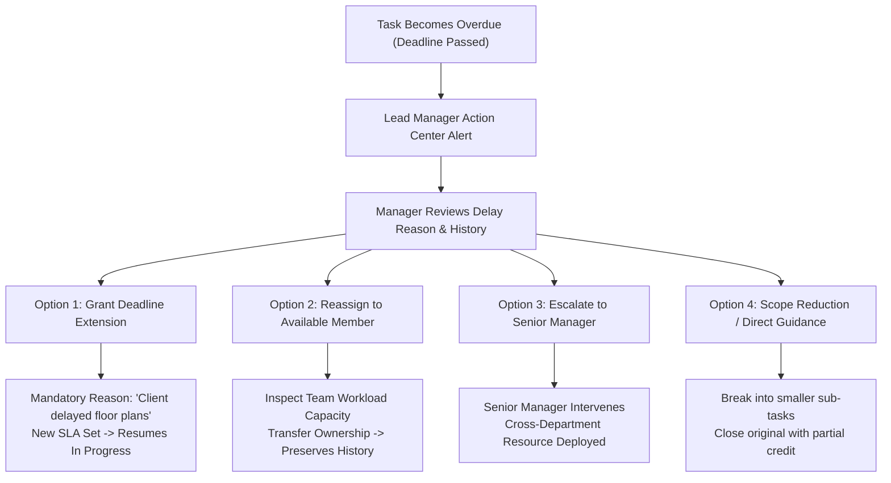
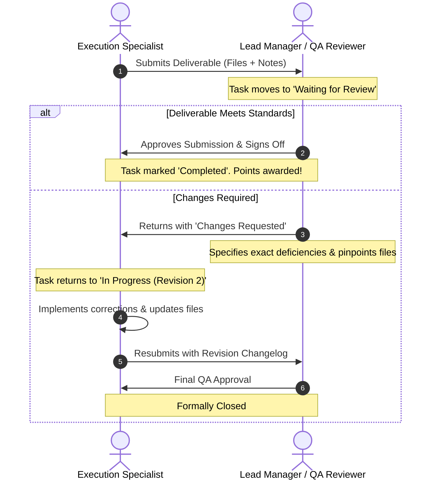

# CIRIL Internal Operations Tracking System (IOTS)
## Chapter 2: Task Lifecycle, Execution Engine & Audit Architecture

> **Document Code:** `IOTS-DOC-02`  
> **Target Audience:** Operational Managers, Execution Specialists, QA Reviewers, and Systems Engineers  
> **Context:** Complete Operational Mechanics of Task Creation, Execution, Overdue Intervention, Reassignment, and Immutable Audit Trails

---

## 1. Executive Summary: The Task as an Indelible Contract

In many organizations, tasks are managed loosely through chat messages, emails, or static spreadsheets. This leads to common failures:
- Instructions are lost or misunderstood.
- Employees get stuck on a roadblock but suffer in silence.
- Deadlines pass without anyone noticing until a client complains.
- When an employee is reassigned, all historical context is lost.

In the **CIRIL IOTS platform**, a task is treated as an **auditable operational contract**. From the moment a Lead Manager creates a task until its final sign-off, every stage, comment, time entry, document upload, and decision is recorded chronologically in an immutable ledger. 

Tasks cannot simply disappear, drift indefinitely, or be deleted without high-level administrative justification.

---

## 2. The Multi-Tier State Machine: Reporting States vs. Execution Micro-States

To maintain both executive clarity and granular operational control, IOTS uses a **dual-layer state architecture**:
1. **Core Reporting States (Macro Level):** Used by Chairman, Senior Managers, and automated intelligence engines to evaluate organizational health.
2. **Operational Micro-States (Micro Level):** Used by Lead Managers and Employees during daily execution.

```mermaid
flowchart TD
    Start([Task Created by Manager]) --> S_Assigned[1. ASSIGNED\n(Allocated with Priority & SLA)]
    
    subgraph ExecutionCycle ["Active Execution Micro-States"]
        S_Assigned --> MS_InProgress["In Progress\n(Work Started, Progress Logged)"]
        MS_InProgress <--> MS_Blocked["Blocked\n(Issue Ticket Raised)"]
        MS_InProgress --> MS_WaitingReview["Waiting for Review\n(Deliverables Submitted)"]
        MS_WaitingReview --> MS_UnderReview["Under Review / QA\n(Manager Inspection)"]
        MS_UnderReview -->|Changes Requested| MS_Revision["Correction Cycle\n(Feedback & Re-execution)"]
        MS_Revision --> MS_WaitingReview
    end
    
    MS_InProgress -.->|Deadline Exceeded| S_Overdue[3. OVERDUE\n(Exception State: Manager Review Required)]
    
    subgraph OverdueIntervention ["Overdue Resolution Engine"]
        S_Overdue --> O_Inspect{Manager Intervention}
        O_Inspect -->|Extend Deadline| MS_InProgress
        O_Inspect -->|Reassign Owner| S_Reassigned[4. REASSIGNED\n(Workload Check & Context Handover)]
        O_Inspect -->|Escalate| O_Escalate["Escalate to Senior Manager"]
    end
    
    S_Reassigned --> MS_InProgress
    
    MS_UnderReview -->|Approved & Signed Off| S_Completed[5. COMPLETED\n(Formally Closed & Points Credited)]

    classDef macro fill:#1e293b,stroke:#38bdf8,stroke-width:2px,color:#fff;
    classDef micro fill:#0f172a,stroke:#a855f7,stroke-width:2px,color:#fff;
    classDef exception fill:#450a0a,stroke:#ef4444,stroke-width:2px,color:#fff;
    classDef success fill:#064e3b,stroke:#10b981,stroke-width:2px,color:#fff;
    
    class S_Assigned,S_Reassigned macro;
    class MS_InProgress,MS_Blocked,MS_WaitingReview,MS_UnderReview,MS_Revision micro;
    class S_Overdue,O_Escalate exception;
    class S_Completed success;
```

---

## 3. The 5 Core Reporting States

| State | Status Type | Definition & Operational Trigger |
| :--- | :---: | :--- |
| **1. ASSIGNED** | Active / Queued | The task has been formally created by a Manager with deliverables, priority tier, and deadline, and assigned to an employee. |
| **2. PENDING** | Active / In-Flight | The employee has acknowledged the assignment and work is underway or queued within standard operational limits. |
| **3. OVERDUE** | Exception Condition | The target deadline has elapsed without an approved completion. This is an active exception requiring immediate managerial intervention. |
| **4. REASSIGNED** | Active Transition | The task has been transferred from one team member to another. **Reassigned is NOT a terminal state**—the task immediately resumes active execution under the new owner. |
| **5. COMPLETED** | Terminal Milestone | Deliverables have been thoroughly reviewed and officially approved by the designated Manager. Historical records are sealed. |

---

## 4. The 7 Operational Micro-States

| Micro-State | Visual Indicator | Trigger & Operational Meaning |
| :--- | :---: | :--- |
| **In Progress** | 🔵 Blue Solid | The employee is actively working on the task, logging time, or incrementally drafting deliverables. |
| **Blocked** | 🔴 Red Striped | The employee has encountered a roadblock (e.g., missing client data, vendor delay) and raised an Issue Ticket. Work is paused. |
| **Waiting for Review**| 🟡 Amber Pulse | The employee has uploaded completed files/links and formally clicked "Submit for Review". |
| **Under Review / QA** | 🟣 Purple Solid | The Manager has opened the submission and is reviewing deliverables against quality criteria. |
| **Changes Requested** | 🟠 Orange Solid | The Manager identified defects or missing elements and returned the submission with itemized revision notes. |
| **Issue Resolved** | 🟢 Teal Solid | The Manager or external stakeholder cleared the reported blocker, enabling work to resume. |
| **Done / Closed** | 🟢 Emerald Solid | The Manager confirmed all acceptance criteria are met, closed the task, and archived deliverables. |

---

## 5. Employee Work Execution & Activity Logging

### The Difference Between State and Activity
A common flaw in rudimentary systems is treating "Work Notes" or "File Uploads" as task states. In IOTS, **States represent where the task sits in the governance pipeline**, while **Work Activities are chronological records created during that state**.

An employee can log ten activities during a single "In Progress" state:

```
┌─────────────────────────────────────────────────────────────────────────────┐
│  TASK-1082: Upload Commercial Listings for Bengaluru Zone                   │
│  State: In Progress | Progress: 75% | Due: Today, 17:00                     │
├─────────────────────────────────────────────────────────────────────────────┤
│  CHRONOLOGICAL ACTIVITY STREAM                                              │
│                                                                             │
│  [10:15 AM] ⏱️ Time Logged: 1h 30m by Manasa                                │
│             Note: "Parsed Whitefield Grade-A office listings from RERA"     │
│                                                                             │
│  [11:45 AM] 📎 Deliverable Uploaded: "Whitefield_Commercial_v1.xlsx"        │
│             Size: 2.4 MB | Verified checksum sha256:7f9a...                 │
│                                                                             │
│  [02:30 PM] 📈 Progress Updated: 40% ➔ 75%                                 │
│             Note: "Completed 38 of 50 office profiles with high-res photos"  │
│                                                                             │
│  [03:15 PM] ⚠️ Blocker Reported: "Missing power load details on Tower C"    │
│             Severity: Medium | Assigned Manager: Ipsheeta                   │
└─────────────────────────────────────────────────────────────────────────────┘
```

### The 4 Structured Work Activities
1. **Progress Percentage Updates:** Slider or numeric input (0% to 100%) indicating completion percentage, accompanied by a mandatory brief summary of work accomplished.
2. **Work Notes & Context Memos:** Freeform text entries capturing operational conversations, client remarks, phone call outcomes, or research findings.
3. **Time-Spent / Effort Logging:** Hours and minutes recorded against the task, allowing IOTS to calculate accurate delivery velocity and prevent employee burnout.
4. **Supporting Deliverables & Evidence:** Direct file attachments (spreadsheets, presentations, PDFs, high-res images) with automatic version indexing and secure cloud storage pointers.

---

## 6. Overdue Handling: Active Managerial Intervention

### The Flaw of "Passive Overdue"
In poorly designed systems, when a task passes its deadline, the badge turns red and sits there forever. The employee feels anxious, and the manager forgets about it until a client calls.

In IOTS, **Overdue is an actionable operational alarm**. When the clock crosses the deadline:
1. The task status transitions automatically from `Pending / In Progress` to `OVERDUE`.
2. A priority alert is dispatched to the Lead Manager’s **Manager Action Center**.
3. The system presents the Lead Manager with a mandatory **Overdue Intervention Workflow**:



### Mandatory Justification for Extensions
A Manager cannot simply click "+1 Day" without entering a formal business justification (e.g., *"Awaiting registered lease copy from Mumbai sub-registrar"*). This justification is permanently recorded in the audit trail, preventing arbitrary deadline drift and holding management accountable.

---

## 7. The Reassignment Protocol

Reassignment is a high-impact managerial decision that occurs when an employee is sick, overloaded, or when specialized expertise is needed.

### Step-by-Step Controlled Reassignment Workflow
1. **Trigger:** Manager selects a task and clicks **"Reassign Task"**.
2. **Workload Assessment:** The system displays the **Team Bandwidth Radar**, showing current task loads of all team members. The manager cannot accidentally assign a critical task to an employee who already has 5 overdue tasks.
3. **Reason Selection:** Manager selects a standardized reassignment category:
   - *Employee Capacity / Overload*
   - *Medical / Approved Leave*
   - *Skillset / Specialized Expertise Required*
   - *Client Vertical Shift*
4. **Context Handover Memo:** The manager writes a mandatory handover note detailing what was completed by the previous owner and what remains.
5. **Indelible Audit Log:** The task is tagged with `Reassigned`. The previous employee is relieved of deadline liability, the new employee receives an urgent handover alert, and both names remain attached to the task history.

---

## 8. The Quality Review & Correction Cycle

Managerial review is never a blunt "Approve" or "Reject". Rejection does not kill the task—it initiates a collaborative correction cycle.



---

## 9. The Reusable Immutable Audit History Component

Every critical object in IOTS (Tasks, User Accounts, Geofences, Leave Requests, and Royalty Settlements) contains an embedded **Audit History Ledger**.

### Immutable Ledger Rules
1. **Append-Only:** Audit records can never be updated, overwritten, or deleted by any user, including Super Admins.
2. **Deterministic Attribution:** Every entry records the unique Actor ID, Actor Name, Active Role, Timestamp (ISO-8601 to the millisecond), Origin IP, and Geolocation Context.
3. **Before & After Delta:** Records precisely what changed (e.g., `Priority: Normal ➔ Critical` or `Status: In Progress ➔ Waiting for Review`).
4. **Source Distinction:** Visually differentiates between **User-Initiated Actions** (e.g., a manager extending a deadline) and **System-Automated Actions** (e.g., the scheduled cron job marking a task overdue).

### Visual Audit Component Specification

```
┌─────────────────────────────────────────────────────────────────────────────┐
│  AUDIT TRAIL: TASK-1082 (Immutable Activity Ledger)                         │
│  Filters: [ All Dates ▼ ] [ All Actors ▼ ] [ All Action Types ▼ ]           │
├─────────────────────────────────────────────────────────────────────────────┤
│                                                                             │
│  📅 30 Sep 2026, 14:15:02 IST | 👤 Ipsheeta (General Manager)              │
│  🏷️ Action: QA Approval Granted                                             │
│  🔄 Delta: Micro-State [Waiting for Review] ➔ [Done / Closed]               │
│  💬 Comment: "All 50 listings verified against RERA database. Excellent."   │
│  🌐 Source: User Action (Web App / Office Geofence)                         │
│  ─────────────────────────────────────────────────────────────────────────  │
│  📅 30 Sep 2026, 11:30:19 IST | 👤 Manasa (Lead Manager)                    │
│  🏷️ Action: Deliverable Resubmission                                        │
│  🔄 Delta: Deliverables Added [Whitefield_v2.xlsx]                          │
│  💬 Comment: "Updated Tower C power load specifications as requested."      │
│  🌐 Source: User Action (Web App / Office Geofence)                         │
│  ─────────────────────────────────────────────────────────────────────────  │
│  📅 30 Sep 2026, 09:00:00 IST | 🤖 IOTS Workflow Engine (System)            │
│  🏷️ Action: Automated Deadline Monitor                                      │
│  🔄 Delta: Alert Dispatched [4 Hours Remaining to SLA Deadline]             │
│  🌐 Source: System Automated Event                                          │
└─────────────────────────────────────────────────────────────────────────────┘
```

---

> Proceed to [**`03_ATTENDANCE_GEOLOCATION_AND_SECURITY_AUDITING.md`**](./03_ATTENDANCE_GEOLOCATION_AND_SECURITY_AUDITING.md) to inspect the geolocation engine, hardware GPS validation, office perimeter geofencing, and remote session auditing.
