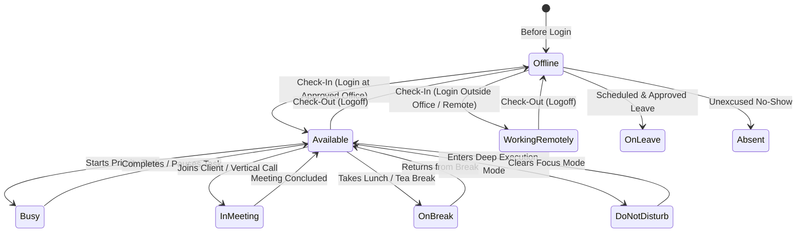
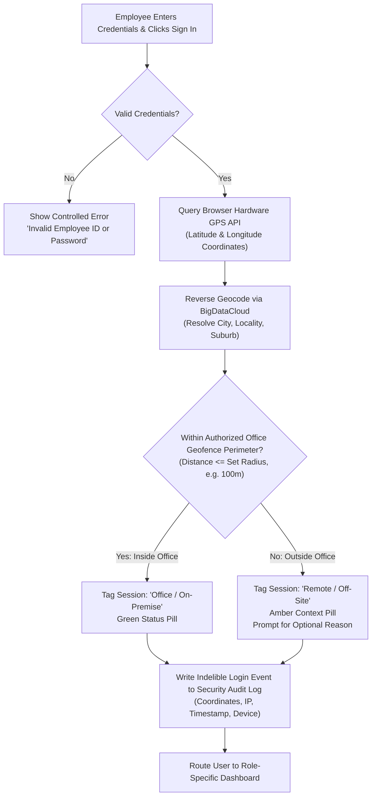
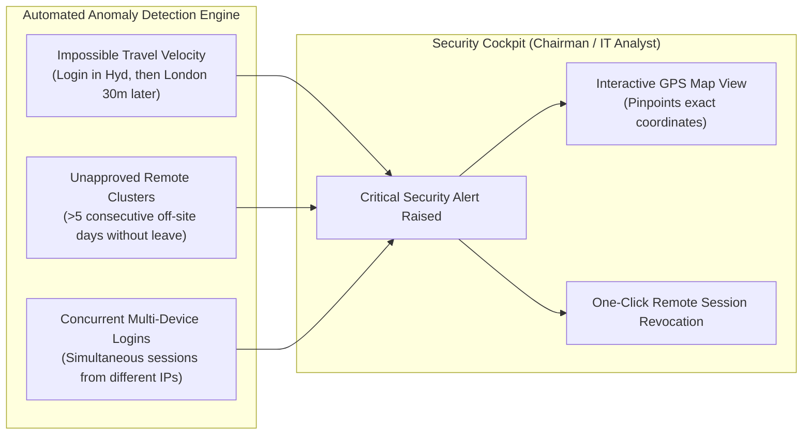

# CIRIL Internal Operations Tracking System (IOTS)
## Chapter 3: Attendance, Geolocation Engine & Security Auditing

> **Document Code:** `IOTS-DOC-03`  
> **Target Audience:** HR Leadership, Security Officers, IT Administrators, Operations Managers, and General Staff  
> **Context:** Complete Mechanics of Attendance Tracking, Real-Time Availability, Hardware GPS Geofencing, Remote Work Validation, and Chairman Security Oversight

---

## 1. Executive Summary: Why Location and Availability Matter

In commercial real estate operations, trust, responsiveness, and accountability are paramount:
- When a corporate client requests an urgent property inspection in Whitefield, Bengaluru, the Lead Manager must know in real time which broker or operations executive is physically available nearby.
- When an employee is handling confidential commercial lease agreements or banking royalty calculations, management must ensure that sessions originate from authorized, secure environments.
- When team members work from home or visit client project sites, the company needs transparent visibility without deploying invasive or disrespectful surveillance software.

The **IOTS Attendance, Geolocation & Security Engine** balances rigorous corporate compliance with a dignified, frictionless employee experience. It validates location silently during login, records work hours automatically, allows employees to communicate their live availability, and equips executive leadership with a comprehensive security radar.

---

## 2. Real-Time Availability State Machine

At any point during the workday, an employee's live availability status is visible across the system (e.g., in team queues, manager radars, and communication panels).



### The 10 Standard Availability States

| Status | Icon / Color | Definition & Operational Impact |
| :--- | :---: | :--- |
| **Available** | 🟢 Green Solid | The employee is logged in, at their desk or approved workstation, and ready to accept new assignments. |
| **Busy** | 🔴 Red Solid | Actively executing a high-priority task. Managers can assign background work, but should avoid urgent interruptions. |
| **In Meeting** | 👥 Blue Solid | Participating in a team standup, zone-wise vertical call, or client briefing. |
| **On Break** | ☕ Amber Solid | Stepped away for lunch, tea, or personal rest. The automated work-timer is paused. |
| **In Training** | 📚 Indigo Solid | Undergoing onboarding, compliance modules, or software training. |
| **Do Not Disturb** | 🔕 Purple Solid | Deep focus mode (e.g., Graphic Designer formatting an annual report or BDE on focused cold-calling). |
| **Working Remotely**| 🏠 Cyan Solid | Logged in from home or an approved off-site location with verified geolocation context. |
| **On Leave** | 🌴 Gray Solid | Formally approved casual, sick, or earned leave. Excluded from daily active task allocations. |
| **Absent** | ❌ Crimson Solid | Unexcused failure to log in within the company grace period. Triggers an HR attendance flag. |
| **Offline** | ⚫ Slate Solid | Logged off at the end of the shift. |

---

## 3. The Geolocation Engine & Office Perimeter Geofencing

### How Geolocation Operates During Unified Login
When an employee enters their credentials on the unified login screen, the system executes a three-step security handshake in milliseconds:



### The Geofencing Mathematics: Haversine Calculation
The server checks the employee's GPS coordinates $(lat_1, lon_1)$ against the master coordinates of the employee’s assigned office $(lat_2, lon_2)$ using the spherical Haversine formula:

$$d = 2R \arcsin\left(\sqrt{\sin^2\left(\frac{\Delta lat}{2}\right) + \cos(lat_1)\cos(lat_2)\sin^2\left(\frac{\Delta lon}{2}\right)}\right)$$

Where $R = 6,371\text{ km}$ (Earth's radius). If $d \le \text{Office Radius}$ (e.g., 100 meters), the session is verified as **Office / On-Premise**.

### Approved CIRIL Office Perimeters (Configured by Admin / Super Admin)
- **CIRIL Central Headquarters (Hyderabad):** Banjara Hills / Hitec City Campus (Radius: 150m)
- **Bengaluru Zonal Office:** MG Road / Indiranagar Hub (Radius: 100m)
- **Mumbai Zonal Office:** Bandra-Kurla Complex (BKC) (Radius: 120m)
- **Delhi-NCR Zonal Office:** Cyber City, Gurugram (Radius: 150m)

---

## 4. Handling Unknown or Remote Login Locations: Dignity Over Fear

### The Layman's Philosophy: No Frightening Error Screens
In legacy corporate software, if an employee logs in from home, a coffee shop, or a client site, the system often locks up, displays a red banner saying *"Access Denied: Unauthorized IP"*, and creates immediate panic.

The **IOTS philosophy is fundamentally different**:
1. **Friendly Transparency:** If an employee is outside the office perimeter, the system does **NOT** block them or treat them as a criminal.
2. **Contextual Tagging:** The system displays a calm, reassuring message:  
   *"We notice you are signing in from outside your designated office perimeter (Gachibowli, Hyderabad). Your session has been marked as **Remote / Off-Site**."*
3. **Optional Reason Memo:** The employee can enter a quick note (e.g., *"Working from home today with prior approval"* or *"Attending client site inspection in Whitefield"*).
4. **Manager Notification:** The Lead Manager sees a subtle orange pin next to the employee’s name on their live team radar, providing immediate situational awareness without bureaucratic friction.

---

## 5. Attendance & Work Hours Computation

### Automated Work Hours Ledger
IOTS eliminates paper registers and manual time tracking:
- **Check-In Timestamp:** Captured automatically upon the first successful login of the day.
- **Check-Out Timestamp:** Captured when the user clicks "Check-Out & Logoff".
- **Net Work Hours:** The system computes active productive time by subtracting logged breaks from the gross session duration:

$$\text{Net Work Hours} = (\text{Check-Out Time} - \text{Check-In Time}) - \sum (\text{Break Durations})$$

### Overtime & Punctuality Scoring
- **Standard Corporate Shift:** 9:30 AM to 6:30 PM (9.0 Gross Hours / 8.0 Net Productive Hours).
- **Grace Period:** 15 minutes (arrivals up to 9:45 AM are marked on-time).
- **Late Arrivals:** Logins after 9:45 AM are flagged as `Late Arrival (Punctuality Flag)`. Three unexcused late arrivals in a calendar month trigger an automated notification to HR and the Lead Manager.

---

## 6. Employee Requests & Self-Service Portal

Employees can manage their work-life schedules directly through the unified self-service portal:

```
┌─────────────────────────────────────────────────────────────────────────────┐
│  SELF-SERVICE REQUEST CENTER                                                │
│  [ + New Request ▼ ]                                                        │
├─────────────────────────────────────────────────────────────────────────────┤
│  TYPE            DATES / TIMES          REASON                 STATUS       │
│  Casual Leave    12 Oct 2026 (1 Day)    Family function        🟢 Approved  │
│  Permission      05 Oct 2026 (2 Hours)  Doctor appointment     🟢 Approved  │
│  Remote Shift    02 Oct 2026 (Full Day) Broadband maintenance  🟡 Pending   │
│  Resource Req    Immediate              Dual-Monitor Display   🟢 Dispatched│
└─────────────────────────────────────────────────────────────────────────────┘
```

### Supported Request Categories
1. **Leave Requests:** Casual Leave (CL), Sick Leave (SL), Earned/Privilege Leave (PL), and Compensatory Off (Comp-Off).
2. **Short Permission Requests:** 1 to 2 hours for doctor appointments, personal emergencies, or government office visits.
3. **Scheduled Remote Work Requests:** Requesting prior approval to work from home for specific days.
4. **Task Clarification / Guidance Requests:** Requesting an urgent 15-minute sync with the Lead Manager to unblock an operational ambiguity.
5. **Operational Resource Requests:** Hardware, specialized software licenses, commercial portal credits (e.g., 99acres credit top-up), or conference stationery.

---

## 7. Security Auditing & Chairman Anomaly Cockpit

### What Executive Leadership and Security Officers See
The **Chairman**, **Super Admin**, and **IT System Analyst** have access to the **Master Security & Location Audit Center**.



### Anomaly Scenarios & Automatic Safeguards
1. **Impossible Travel Velocity:** If User A logs in from Hyderabad at 10:00 AM, and the same account logs in from Dubai at 10:45 AM, the system detects physical impossibility ($>800\text{ km/h}$), suspends the second session, dispatches an urgent SMS/email alert to the employee, and flags the event in the IT Analyst dashboard.
2. **Ghost Logins & Session Hijacking:** Active sessions are bound to a cryptographically signed browser token and hardware fingerprint. If cookies are copied to a different browser, the session is immediately invalidated.
3. **Full Location Audit History:** Every login event is preserved with its reverse-geocoded address, GPS coordinates, public IP address, ISP provider, and browser user-agent. This data is available to the Chairman to maintain complete institutional compliance.

---

> Proceed to [**`04_CIRIL_COMMERCIAL_OPERATIONS_AND_REVENUE_INTEGRATION.md`**](./04_CIRIL_COMMERCIAL_OPERATIONS_AND_REVENUE_INTEGRATION.md) to examine how the IOTS platform directly supports CIRIL's commercial deals, 7.5% corporate royalty calculations, and proprietary market research.
