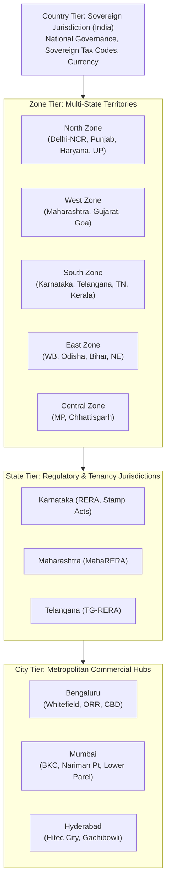
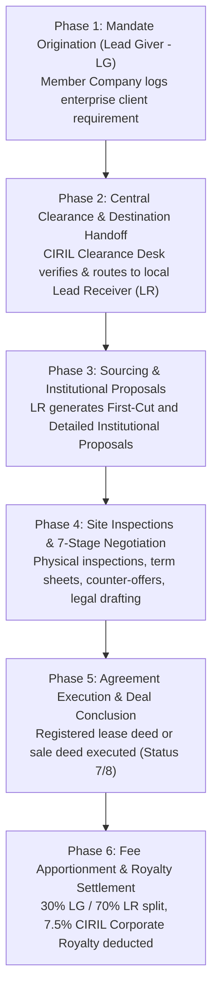

# CIRIL Internal Operations Tracking System (IOTS)
## Chapter 4: CIRIL Commercial Operations, Revenue Architecture & Market Intelligence

> **Document Code:** `IOTS-DOC-04`  
> **Target Audience:** Commercial Real Estate Brokers, Financial Controllers, Alliance Managers, and Executive Leadership  
> **Context:** Complete End-to-End Syndication Model, 6-Phase Deal Flow, 30/70 Inter-Member Split, 7.5% Corporate Royalty Mechanics, and Proprietary Research

---

## 1. Executive Summary: The CIRIL Syndication Model

Traditional commercial real estate brokerage is fragmented and localized. A brokerage firm in Mumbai might have an exceptional relationship with a multinational bank, but when that bank needs a 100,000 sq ft logistics warehouse in Chennai or a research campus in Hyderabad, the local brokerage faces severe challenges:
1. They lack local market inventory and developer connections in other cities.
2. Referring the lead informally leads to disputes over fee sharing.
3. Proposal formats and professionalism vary wildly across regions.
4. Corporate occupiers struggle with inconsistent points of contact.

**CIRIL** resolves this by operating as an **apex clearinghouse and national alliance** of certified commercial real estate advisory firms (Member Companies). CIRIL provides the national umbrella, standardized institutional proposal templates, trusted escrow dispute resolution, proprietary market intelligence, and automated fee distribution.

The **Internal Operations Tracking System (IOTS)** serves as the operational backbone that manages these transactions, calculates fee distributions, tracks corporate royalty collection, and powers CIRIL's research engine.

---

## 2. The 4-Tier Geographic Hierarchy

The administrative engine organizes all transactions, listings, member companies, and broker teams into a structured territorial matrix:

---

## 3. The 6-Phase End-to-End Transaction Lifecycle

Every corporate mandate flowing through the CIRIL alliance moves through a structured, auditable six-phase workflow:

### Phase 1: Mandate Origination (Lead Giver Stage)
A Member Company in City A secures a mandate from an enterprise client (e.g., an IT company seeking 50,000 sq ft in City B). The originating broker logs the mandate in IOTS with comprehensive parameters:
- Space category & vertical (Grade-A Office, Logistics & Warehousing, Retail, Hotel, Land)
- Required area (chargeable vs. carpet square footage)
- Target budget / maximum asking rent
- Technical requirements (power load, HVAC specifications, floor efficiency, car parking ratios)

### Phase 2: Central Clearance & Destination Handoff
CIRIL Headquarters (managed by the **Lead Manager / General Manager**) verifies the mandate for completeness and routes it to an accredited Member Company in the destination city (**Lead Receiver**). The recipient receives an automated notification and must formally **Accept** or **Reject** the lead within 24 hours, locking in mutual representation covenants.

### Phase 3: Sourcing & Institutional Proposals
The Lead Receiver sources suitable inventory from developers and leverages CIRIL's built-in proposal engine:
- **First-Cut Proposal:** A standardized matrix comparing 3 to 5 viable property options with key commercial parameters and asking rates.
- **Detailed Institutional Proposal:** An exhaustive institutional report featuring building specifications, floor plates, developer credibility ratings, compliance certificates, and commercial lease models.

### Phase 4: Inspections & The 7-Stage Negotiation Pipeline
The transaction advances through seven auditable negotiation milestones:
1. *Basic Prospecting & Property Identification*
2. *Physical Site Inspection Conducted*
3. *Shortlisting & Developer RFPs*
4. *Commercial Offer Submission*
5. *Non-Binding Term Sheet / LOI Finalization*
6. *Legal Drafting & Title Due Diligence*
7. *Final Agreement Execution & Registration*

### Phase 5: Deal Conclusion & Financial Milestone Lock
Upon execution of the registered lease deed or sale deed, the mandate enters **Status 7/8 (Concluded)**. The Lead Receiver enters confirmed transaction metrics (actual area leased, final rent per sq ft, lock-in duration, or total capital consideration). The manager reviews the figures and clicks **"Calculations Completed"**, locking the economics against further editing.

### Phase 6: Fee Apportionment & Royalty Settlement
The financial engine computes the gross brokerage, divides the proceeds between the Lead Giver and Lead Receiver according to alliance guidelines, extracts CIRIL’s 7.5% corporate royalty, and dispatches official conclusion statements to all parties.

---

## 4. Commercial Mathematics & Fee Structures

CIRIL operates an asset-light, high-margin alliance model. Revenue is generated from two primary categories of commercial real estate transactions:

### 4.1 Base Brokerage Calculation Formulas

| Deal Classification | Valuation Base Formula | Standard Gross Brokerage Pool |
| :--- | :--- | :--- |
| **Commercial Lease / Rental** | $\text{Gross Rent} = \text{Monthly Rent / sq ft} \times \text{Chargeable Area (sq ft)}$ | **1 Month (30 Days) Rental Value** *(or $\text{Rent} \times \frac{\text{Lease Days}}{30}$ for pro-rated leases)* |
| **Outright Sale / Acquisition** | $\text{Total Consideration} = \text{Capital Rate / sq ft} \times \text{Total Area (sq ft)}$ | **Fixed 1.00% of Total Transaction Consideration** |

---

### 4.2 Inter-Member Brokerage Split (LG vs. LR)

The gross brokerage pool is distributed fairly between the originator and the local executor:
- **Lead Giver (LG) Share — 30%:** Compensates the member firm that captured, qualified, and introduced the enterprise corporate relationship.
- **Lead Receiver (LR) Share — 70%:** Compensates the executing member firm for conducting property searches, physical inspections, landlord negotiations, developer coordination, and legal closing.

*(Note: Custom split percentages agreed bilaterally between member partners prior to lead acceptance are supported, provided CIRIL’s overarching royalty covenant is preserved).*

---

### 4.3 The CIRIL Corporate Royalty Engine (7.5%)

CIRIL central headquarters earns a dedicated **7.5% corporate royalty** deducted proportionally from both participating member partners:

$$\text{LG Royalty Contribution} = 7.5\% \times \text{Lead Giver Share}$$

$$\text{LR Royalty Contribution} = 7.5\% \times \text{Lead Receiver Share}$$

$$\text{Total CIRIL Corporate Royalty} = \text{LG Royalty Contribution} + \text{LR Royalty Contribution} = 7.5\% \times \text{Total Gross Brokerage}$$

---

### 4.4 Financial Simulation Scenarios: Exact Worked Models

The table below illustrates the exact mathematical cash flow distribution across both deal types:

| Financial Metric | Scenario A: Grade-A Office Lease | Scenario B: Outright Land / Asset Acquisition |
| :--- | :--- | :--- |
| **Deal Parameters** | 50,000 sq ft @ ₹80 / sq ft / month | 100,000 sq ft @ ₹2,500 / sq ft capital rate |
| **Gross Transaction Value** | ₹40,00,000 / month rent | ₹25,00,00,000 (₹25 Crore Consideration) |
| **Total Gross Brokerage Pool** | **₹40,00,000** (1 Month Rental) | **₹25,00,000** (1.00% Consideration) |
| **Lead Giver Share (30% Gross)** | ₹12,00,000 | ₹7,50,000 |
| **Lead Receiver Share (70% Gross)** | ₹28,00,000 | ₹17,50,000 |
| **Royalty Contributed by LG (7.5%)** | ₹90,000 | ₹56,250 |
| **Royalty Contributed by LR (7.5%)** | ₹2,10,000 | ₹1,31,250 |
| **Net CIRIL Corporate Royalty (7.5%)** | **₹3,00,000** | **₹1,87,500** |
| **Net Retained by Lead Giver (LG)** | **₹11,10,000** (92.5% of LG Share) | **₹6,93,750** (92.5% of LG Share) |
| **Net Retained by Lead Receiver (LR)** | **₹25,90,000** (92.5% of LR Share) | **₹16,18,750** (92.5% of LR Share) |

---

## 5. How Internal Operations Staff Manage Commercial Deals in IOTS

The IOTS system directly maps to the real daily tasks of CIRIL's operations personnel (as documented in CIRIL's staff rosters):

### 1. Manasa (Lead Manager - Operations)
- **Royalty Tracking & Concluded Deals:** Monitors concluded transactions, reviews the 30/70 split calculations, locks financial calculations, and follows up with member offices for timely 7.5% royalty remittances.
- **Vertical Coordination Calls:** Conducts weekly coordination calls across four specialized commercial verticals: **Retail**, **Logistics & Warehousing (L&W)**, **Land**, and **Hotel**.
- **Office Listing Management:** Uploads verified commercial listings to portal databases and routes tenant inquiries directly to the respective member offices.
- **Quarterly Member Ratings & Lead Exchanges:** Prepares quarterly matrices detailing lead volume exchanged between member offices, calculates member performance ratings, and distributes reports.
- **Conferences & Print Vendors:** Coordinates with printing vendors for stationery, identity cards, attendee nameplates, and quarterly market report booklets for Zonal and Annual Conferences.

### 2. Bhavani (Business Development Executive)
- **Network Expansion:** Conducts daily outreach to prospective commercial brokerage firms across tier-1 and tier-2 cities to join the CIRIL alliance.
- **Database Mining:** Gathers and verifies commercial broker contacts from state RERA portals, Google databases, and industry directories.
- **Lead Generation Portals:** Actively manages **Upturnly** and **99acres** portals to capture commercial occupier leads.
- **WhatsApp Campaigns:** Coordinates outbound WhatsApp sequences presenting CIRIL’s co-brokerage benefits.

### 3. Harshitha (Social Media Manager & Operations Executive)
- **End-to-End Social Media:** Publishes deal announcements, market statistics, and member spotlights across LinkedIn, Instagram, and YouTube.
- **Market Report Proofreading:** Validates quarterly research publications for grammatical accuracy, statistical consistency, and branding standards before distribution.
- **Office Vertical Calls:** Coordinates zone-wise client and broker calls for the Grade-A Office space vertical.
- **Conference Presentations:** Collaborates with the Graphic Designer to produce keynote slide decks, speaker visuals, and photo archives.

### 4. Ipsheeta (General Manager - Admin & Expansions)
- **Board Governance:** Coordinates with the Board of Directors, organizes quarterly board meetings, drafts official agendas and minutes, and tracks boardroom decisions.
- **Legal Compliance & Contracts:** Coordinates with corporate counsel for membership agreements, non-disclosure agreements (NDAs), and dispute settlements.
- **Finance & Accounting Oversight:** Liaises with the accounts department to track corporate royalty invoices, member dues, and event budgets.
- **High-Level Expansion Presentations:** Conducts executive pitch meetings with managing directors of prospective member firms.

### 5. Chairman
- **Apex Executive Radar:** Reviews the complete corporate royalty ledger, active multi-city pipelines, quarterly member performance scorecards, and overall network health.

---

## 6. Proprietary Market Intelligence Engine

Beyond transaction tracking, IOTS integrates CIRIL’s proprietary commercial market intelligence engine:

1. **Rental Trends Benchmark:** Continuously tracks micro-market rental movements, vacancy absorptions, and effective lease rates across commercial corridors (e.g., ORR Bengaluru vs. BKC Mumbai).
2. **Landmark Deals Archive:** Catalogs major multi-thousand square-foot leases closed across BFSI, IT/ITeS, and manufacturing sectors.
3. **Upcoming Supply Pipeline:** Maintains a verified registry of under-construction commercial towers and industrial parks with expected completion timelines.
4. **Landlord & Tenant Data Mining:** Tracks upcoming enterprise lease expirations to trigger early client renewals and mandate origination.

---

> Proceed to [**`05_INTELLIGENCE_ANALYTICS_AND_AUTOMATED_REPORTING.md`**](./05_INTELLIGENCE_ANALYTICS_AND_AUTOMATED_REPORTING.md) to discover the daily, weekly, and monthly analytical engines, exception detection, and automated report distribution.
