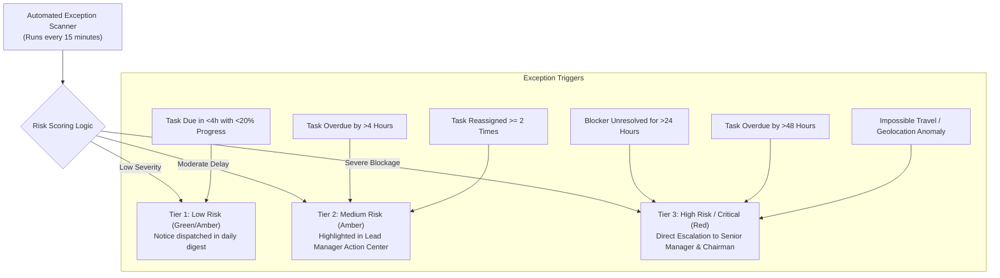

# CIRIL Internal Operations Tracking System (IOTS)
## Chapter 5: Intelligence, Analytics & Automated Reporting Layer

> **Document Code:** `IOTS-DOC-05`  
> **Target Audience:** Executive Leadership, Department Heads, Operational Analysts, and Lead Managers  
> **Context:** Architecture of the 3rd System Layer, Cadence Rhythms, 6 Analytical Modules, Exception Risk Scoring, and Automated Distribution

---

## 1. Executive Summary: Transforming Operational Exhaust into Management Wisdom

Every day, an enterprise generates thousands of operational data points: logins, task updates, file uploads, approval clicks, time entries, blockers, and location pings. In traditional companies, this data is treated as "operational exhaust"—discarded or locked inside individual logs.

The **Intelligence & Analytical Layer** is the third core layer of the IOTS platform. It continuously harvests this data to provide actionable management intelligence. 

### The Enterprise Visual Principle: Zero Decorative Charts
A common failing in modern business software is cluttering dashboards with colorful, meaningless 3D pie charts or bouncing animations that look impressive in marketing demos but tell an executive nothing useful.

In IOTS, **every chart must answer a vital business question**:
- *Are client proposals being delivered on schedule?*
- *Which specific employee is facing burnout from workload concentration?*
- *Why is a particular task being repeatedly reassigned?*
- *Where are unresolved blockers causing deal delays?*

---

## 2. The 3 Reporting Rhythms: Daily, Weekly, and Monthly Rhythms

Operational intelligence operates across three distinct time horizons:

```mermaid
flowchart LR
    subgraph DailyRhythm ["Daily Rhythm (Operational Discipline)"]
        D_Digest["Daily Operational Digest\n(Generated 18:30 IST)"]
        D_Focus["Focus: Tasks Completed Today, Overdue Items, Unresolved Blockers, Tomorrow's Priorities"]
        D_Audience["Audience: Employees & Lead Managers"]
    end

    subgraph WeeklyRhythm ["Weekly Rhythm (Tactical Coordination)"]
        W_Report["Weekly Departmental Review\n(Generated Monday 09:00 IST)"]
        W_Focus["Focus: SLA On-Time Delivery Rate, Workload Rebalancing, Team Capacity Trends"]
        W_Audience["Audience: Senior Managers & General Manager"]
    end

    subgraph MonthlyRhythm ["Monthly Rhythm (Strategic & Reward Oversight)"]
        M_Executive["Monthly Executive Scorecard\n(Generated 1st of Month)"]
        M_Focus["Focus: Departmental Target Fulfillment, Royalty Settlements, Reward System Standings"]
        M_Audience["Audience: Chairman & Board of Directors"]
    end

    DailyRhythm --> WeeklyRhythm
    WeeklyRhythm --> MonthlyRhythm
```



---

## 3. The 6 Dedicated Analytics Centers

```
┌─────────────────────────────────────────────────────────────────────────────┐
│  INTELLIGENCE & ANALYTICAL CENTER                                           │
│  Time Range: [ Last 30 Days ▼ ]   Compare: [ vs. Previous Period ▼ ]         │
├─────────────────────────────────────────────────────────────────────────────┤
│  [1. Performance] [2. Workload] [3. Attendance] [4. Trends] [5. Risk] [6. AI]│
└─────────────────────────────────────────────────────────────────────────────┘
```

---

### Center 1: Performance & Velocity Analytics
Answers: *How fast, how well, and how consistently are teams delivering work?*
- **Task Completion Rate:** The percentage of assigned tasks successfully brought to `Completed` status within the evaluation window:

$$\text{Completion Rate} = \left(\frac{\text{Completed Tasks}}{\text{Total Assigned Tasks}}\right) \times 100$$

- **On-Time SLA Delivery Rate:** Percentage of tasks closed before the initial agreed deadline:

$$\text{On-Time Delivery Rate} = \left(\frac{\text{Tasks Completed On or Before Deadline}}{\text{Total Completed Tasks}}\right) \times 100$$

- **Average Turnaround Duration:** Mean time elapsed from `Assigned` to `Completed` across different task categories.
- **Rework & Revision Index:** Frequency of tasks returned by managers with `Changes Requested`. A low revision index indicates clear instructions and high execution competence.

---

### Center 2: Task & Workload Distribution Analytics
Answers: *Is work distributed fairly, or are specific individuals becoming bottlenecks?*
- **Team Workload Capacity Radar:** Compares the active task commitments of each team member against their standard 8-hour daily capacity.
- **Concentration Analysis:** Identifies if 80% of critical tasks are loaded onto 20% of staff.
- **Task Pipeline Distribution:** Real-time breakdown of tasks currently in `Assigned`, `In Progress`, `Waiting for Review`, and `Done`.

```
┌─────────────────────────────────────────────────────────────────────────────┐
│  TEAM CAPACITY RADAR (OPERATIONS TEAM)                                      │
├─────────────────────────────────────────────────────────────────────────────┤
│  Employee       Active Tasks   Capacity Load   Status                       │
│  Manasa         6 Tasks        110% ⚠️         Overloaded (Rebalance Rec.)  │
│  Harshitha      4 Tasks         80% 🟢         Optimal Operating Range      │
│  Bhavani        3 Tasks         65% 🟢         Available for Allocation     │
│  Ashwin         1 Task          25% 🟡         Under-utilized               │
└─────────────────────────────────────────────────────────────────────────────┘
```

---

### Center 3: Attendance & Workforce Health Analytics
Answers: *Are teams present, punctual, and working in healthy, authorized environments?*
- **Punctuality Index:** Percentage of on-time check-ins within the 15-minute morning grace period.
- **Attendance Consistency:** Tracking unplanned absences, sick leave frequencies, and earned leave utilization.
- **Workplace Ratio:** Percentage of total operational hours logged `On-Premise (Office Geofence)` vs. `Remote / Off-Site`.
- **Availability Patterns:** Aggregate tracking of hours spent in `Available`, `Busy`, `In Meeting`, and `On Break`.

---

### Center 4: Trend & Historical Pattern Analysis
Answers: *Are we improving over time, or are delays becoming systemic?*
- **Time Horizon Comparative Analysis:** Provides instant comparison toggles:
  - *Today vs. Yesterday*
  - *This Week vs. Last Week*
  - *Last 30 Days vs. Prior 30 Days*
  - *Quarter-to-Date vs. Prior Quarter*
- **Velocity Trends:** Tracks whether the team’s average task turnaround time is accelerating or stagnating over successive months.

---

### Center 5: Exception & Risk Analysis (The 3-Tier Risk Engine)
Answers: *Where are the operational fires that require immediate leadership intervention?*

The system continuously scans all operational data and classifies exceptions into three standardized risk tiers:



#### Standardized Risk Tiers

| Risk Tier | Criteria & Triggers | Automated System Response |
| :--- | :--- | :--- |
| **Tier 1: Low Risk** | • Task due within 4 hours with progress below 30%.<br>• First-time minor punctuality flag.<br>• Single revision requested on deliverable. | Informational alert displayed in employee workspace; logged in daily digest. |
| **Tier 2: Medium Risk** | • Task overdue by 4 to 24 hours.<br>• Task reassigned 2 or more times.<br>• Employee capacity exceeds 110%.<br>• Blocker open for >8 working hours. | Flashes amber in Lead Manager Action Center; demands active resolution. |
| **Tier 3: High Risk / Critical** | • Task overdue by >48 hours without approved extension.<br>• Unresolved blocker halting commercial deal closing.<br>• Repeated unexcused absence flags.<br>• Impossible travel velocity or security anomaly. | Escalates to Senior Manager and Chairman Executive Cockpit; requires logged intervention. |

---

### Center 6: Predictive Operational Signals

To prevent missed deadlines before they happen, IOTS provides **Predictive Signals**. These are deterministic operational warnings based on mathematical thresholds (not fabricated AI certainty):

1. **SLA Breach Warning:** If an employee has 2 hours remaining before a deadline, but the average completion duration for that task type is 4 hours and current progress is only 15%, the system displays a `Potential SLA Breach` alert.
2. **Burnout Early-Warning:** If an employee logs $>10$ net work hours for 4 consecutive days while maintaining $>100\%$ capacity load, the system alerts the Lead Manager to rebalance tasks.
3. **Vendor Bottleneck Warning:** If historical data reveals that a specific print vendor takes 4 days to deliver conference brochures instead of the promised 2 days, the system prompts the Lead Manager to adjust milestone schedules proactively.

---

## 4. Role-Scoped Automated Report Delivery

Rather than sending a single generic 50-page document to everyone, IOTS automatically slices and delivers role-scoped reports on a scheduled cron:

```
┌─────────────────────────────────────────────────────────────────────────────┐
│  AUTOMATED SCHEDULED REPORT ENGINE                                          │
├─────────────────────────────────────────────────────────────────────────────┤
│  REPORT NAME       FREQUENCY    CADENCE        RECIPIENTS      FORMAT       │
│  Executive Radar   Monthly      1st of Month   Chairman, GM    PDF / Deck   │
│  Multi-Team Ops    Weekly       Mon 09:00 IST  Senior Managers PDF / Sheet  │
│  Team Action Plan  Daily        Daily 18:30    Lead Managers   Web / Email  │
│  Personal Score    Monthly      1st of Month   All Employees   Web / Modal  │
└─────────────────────────────────────────────────────────────────────────────┘
```

### Role-Scoped Delivery Matrix
- **To the Chairman:** 2-page Executive Radar summarizing enterprise operational health, 7.5% royalty remittance totals, critical escalations resolved, and 3-month consecutive award candidates.
- **To General Manager & Senior Managers:** Cross-departmental workload matrices, SLA delivery trends, overdue resolution audits, and member alliance coordination status.
- **To Lead Managers:** Actionable daily checklists: tasks needing QA review, pending leave approvals, overdue interventions, and live team availability rosters.
- **To Execution Staff (Executives, BDEs, Social Media, Designers):** Personal monthly performance scorecards showing completed tasks, on-time delivery percentages, time tracked, and reward milestone progress.

---

> Proceed to [**`06_EMPLOYEE_PERFORMANCE_REWARD_AND_RECOGNITION_SYSTEM.md`**](./06_EMPLOYEE_PERFORMANCE_REWARD_AND_RECOGNITION_SYSTEM.md) to inspect the monthly and quarterly reward frameworks, 3-consecutive-month criteria, and incentive formulas.
