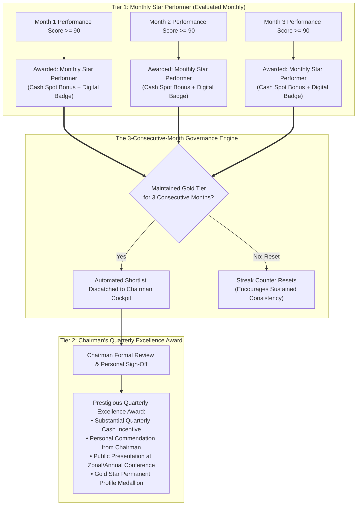

# CIRIL Internal Operations Tracking System (IOTS)
## Chapter 6: Employee Performance, Reward & Recognition System

> **Document Code:** `IOTS-DOC-06`  
> **Target Audience:** All Employees, Lead Managers, HR Leadership, and Chairman  
> **Context:** Objective Performance Measurement, Monthly Star Performer Recognition, and the 3-Consecutive-Month Chairman's Quarterly Excellence Award

---

## 1. Executive Summary: The Philosophy of Objective Recognition

In many conventional organizations, bonuses, awards, and recognitions are decided through subjective impressions, recency bias, or office politics. This damages morale:
- High-performing, quiet specialists who consistently deliver flawless work are often overlooked.
- Team members only know how they are performing once a year during stressful annual reviews.
- Recognition feels arbitrary rather than earned.

The **CIRIL IOTS Performance, Reward & Recognition System** establishes complete objectivity and transparency. Because every task, delivery timestamp, review cycle, and attendance record is already captured accurately in the platform's execution layer, recognition is calculated through **transparent mathematical scoring**.

Every employee can see their live performance score and reward trajectory directly on their personal workspace dashboard every single day.

---

## 2. The Dual-Tier Reward Architecture: Monthly & Quarterly Rhythms

To balance short-term motivation with sustained, long-term operational excellence, the reward framework is divided into two distinct tiers:



---

## 3. The Comprehensive Performance Scoring Formula (100-Point Scale)

At the end of each calendar month, the IOTS Intelligence Engine computes an **Overall Monthly Performance Score ($S_{\text{perf}}$)** on a 100-point scale:

```
┌─────────────────────────────────────────────────────────────────────────────┐
│  MONTHLY PERFORMANCE SCORECARD BREAKDOWN (100 POINTS)                       │
├─────────────────────────────────────────────────────────────────────────────┤
│  1. Task Delivery & Velocity        [███████████████████░░░░]  35 Points    │
│  2. On-Time SLA Achievement         [████████████████░░░░░░░]  30 Points    │
│  3. First-Time Quality & Revision   [████████░░░░░░░░░░░░░░░]  15 Points    │
│  4. Punctuality & Location Standing [██████░░░░░░░░░░░░░░░░░]  10 Points    │
│  5. Initiative & Blocker Resolution [██████░░░░░░░░░░░░░░░░░]  10 Points    │
├─────────────────────────────────────────────────────────────────────────────┤
│  TOTAL SCORE: 94 / 100 ➔ TIER: GOLD (Star Performer Candidate)              │
└─────────────────────────────────────────────────────────────────────────────┘
```

### Mathematical Component Breakdown

$$S_{\text{perf}} = P_{\text{vol}} + P_{\text{sla}} + P_{\text{qual}} + P_{\text{punct}} + P_{\text{init}}$$

#### 1. Task Delivery & Velocity ($P_{\text{vol}}$, Max 35 Points)
Measures the volume of assigned operational work successfully brought to final approved completion:

$$P_{\text{vol}} = 35 \times \left(\frac{\text{Completed Tasks}}{\text{Total Assigned Tasks}}\right)$$

#### 2. On-Time SLA Achievement ($P_{\text{sla}}$, Max 30 Points)
Measures delivery discipline and commitment to deadlines:

$$P_{\text{sla}} = 30 \times \left(\frac{\text{Tasks Completed On or Before Initial Deadline}}{\text{Total Completed Tasks}}\right)$$

#### 3. First-Time Quality & Revision Index ($P_{\text{qual}}$, Max 15 Points)
Rewards delivering high-standard work that requires minimal managerial rework. Deducts points if tasks are repeatedly returned with `Changes Requested`:

$$P_{\text{qual}} = 15 \times \left(1 - \frac{\text{Tasks Returned for Revision}}{\text{Total Submissions}}\right)$$

#### 4. Punctuality & Location Integrity ($P_{\text{punct}}$, Max 10 Points)
Rewards consistent attendance, punctuality, and adherence to approved office perimeters or verified remote protocols:
- 10 Points: 100% on-time arrivals, zero unexcused location anomalies.
- Deductions: -2 points per unexcused late arrival beyond the monthly grace quota.

#### 5. Initiative & Blocker Resolution ($P_{\text{init}}$, Max 10 Points)
Evaluated by the Lead Manager during monthly reviews for proactive problem-solving, helping colleagues unblock work, and positive communication.

---

## 4. Performance Tiers & Monthly Rewards

| Tier Name | Score Range | Operational Standing | Monthly Reward & Recognition |
| :--- | :---: | :---: | :--- |
| **Gold Tier** | **90 – 100** | Exceptional Delivery | • **"Star Performer of the Month"** Digital Badge on Profile<br>• Cash Spot Bonus / Digital Voucher<br>• Spotlight feature on Enterprise Announcement Board<br>• Counts as 1 Month toward the 3-Month Consecutive Award |
| **Silver Tier** | **80 – 89** | Strong & Reliable | • "High Achiever" Commendation in Team Standup<br>• Full quarterly performance bonus eligibility |
| **Bronze Tier** | **70 – 79** | Standard Operations | • Meets baseline corporate expectations |
| **Needs Focus** | **< 70** | Below Benchmark | • Triggers constructive 1-on-1 coaching with Lead Manager<br>• Automated review of workload or training gaps |

---

## 5. The 3-Consecutive-Month Chairman's Quarterly Excellence Award

### The Rule of Unwavering Consistency
Any employee can have a lucky month or a short burst of frantic effort. True institutional excellence, however, is demonstrated through **sustained consistency**.

The platform enforces the **3-Consecutive-Month Rule**:
1. **Continuous Qualification:** An employee must achieve the **Gold Tier ($S_{\text{perf}} \ge 90$)** in **three consecutive calendar months** (e.g., October, November, and December).
2. **The Reset Covenant:** If an employee achieves Gold in Month 1 and Month 2, but dips to Silver (85) in Month 3, the consecutive streak counter resets to zero. This ensures that the Chairman’s award is reserved for individuals of remarkable dependability.
3. **Chairman Direct Cockpit Shortlist:** Upon completion of the third consecutive Gold month, the IOTS system automatically generates a **Chairman Quarterly Honours Dossier**, presenting the employee's 90-day activity summary, client feedback, and delivery statistics.
4. **Executive Commendation:** The Chairman reviews the dossier and signs off on the award.

### Quarterly Honours Package
- **Substantial Cash Incentive:** Dispatched alongside the quarterly payroll.
- **Formal Chairman's Trophy & Framed Commendation:** Presented publicly during the opening ceremonies of CIRIL's Annual or Zonal Conference.
- **Permanent Gold Star Profile Medallion:** Displayed alongside the employee's name across all system modules, identifying them as an institutional pillar of CIRIL.
- **Fast-Track Career Progression:** Serves as the primary prerequisite for promotions from Executive to Lead Manager, or Lead Manager to Senior Manager.

---

## 6. Role-Specific KPI Customization

To ensure complete fairness across diverse functional departments, the scoring engine tailors metrics according to role:

### 1. Business Development Executive (BDE - Bhavani)
- Outreach volume (calls logged, introductory emails sent, WhatsApp sequences active).
- Prospect pipeline conversions (prospective brokerage firms engaged from RERA/directories).
- Follow-up adherence (zero overdue callbacks in the follow-up queue).

### 2. Social Media Manager (Harshitha)
- Content calendar adherence (posts drafted, reviewed, and published on schedule).
- Market report proofreading timeliness (zero delays in research document release).
- Campaign delivery (timely distribution of conference slide decks and speaker collaterals).

### 3. Graphic Designer
- Creative turnaround speed (time from design brief acceptance to Draft v1).
- Version iteration efficiency (achieving final approval within $\le 2$ revision cycles).
- Conference collaterals print readiness (zero print-run rejections by printing vendors).

### 4. Operations Lead / Lead Manager (Manasa)
- Team SLA adherence (percentage of team tasks completed without manager overdue intervention).
- Royalty calculation accuracy (zero financial errors on the 7.5% royalty and 30/70 splits).
- Workload balance health (zero team members experiencing prolonged capacity overload).

---

## 7. Dignity & Anti-Burnout Safeguards

A healthy reward system inspires excellence without encouraging toxic behavior:
1. **No Midnight Heroics Required:** The system strictly caps points earned from daily work hours at standard shift durations. Working 14-hour days does not grant extra points; completing tasks efficiently and accurately within standard hours is what earns top marks.
2. **Transparent Dispute Resolution:** If an employee feels their score was unfairly affected by an external blocker (e.g., a client taking two weeks to sign a lease deed), they can submit a 1-click **Score Review Request** to the Senior Manager, who can audit the timestamps and adjust the score if justified.
3. **Open Self-Inspection:** Employees can click on any score component to view the exact math and underlying operational records that produced it.

---

> Proceed to [**`07_ENTERPRISE_UI_UX_DESIGN_SYSTEM_AND_DASHBOARD_BLUEPRINTS.md`**](./07_ENTERPRISE_UI_UX_DESIGN_SYSTEM_AND_DASHBOARD_BLUEPRINTS.md) to inspect the enterprise UI/UX specifications, unified application shell, and complete dashboard blueprints for all 11 roles.
