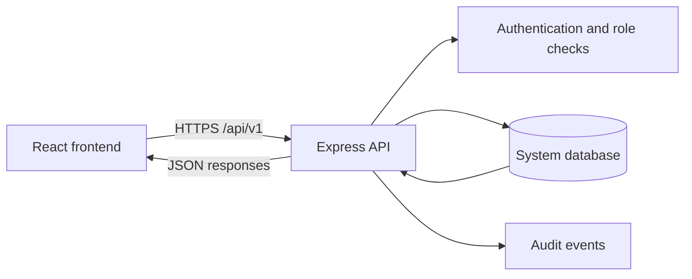

# IOTS Frontend–Backend Integration Plan

**Purpose:** Connect the existing React frontend and Express backend through a clear API and shared persistent data model, then implement the operational workflows in the order required by `documentation/iots-system.drawio`.

**Plan status:** Proposed implementation sequence. The diagram and supporting documents describe intended behavior; they are not evidence that those features already exist in the application.

## Current state found in the repository

- `iots-app/frontend` is a React 19 / Vite application. Its current user-facing implementation is primarily a login and location experience.
- In `frontend/src/App.jsx`, credential verification, geofence verification, audit posting, and post-login routing are placeholders or commented examples. Login outcomes are currently simulated with local scenario state.
- The frontend Vite server runs on port 5173. Its proxy object is currently empty, so `/api` requests have no development route to the backend.
- `iots-app/backend` has an Express 5 package manifest and a start script for `node index.js`, but no `index.js` or API implementation is currently present. Its declared runtime dependencies are Express and dotenv; there is no database or CORS package configured.
- `documentation/login_page/04_SERVER_ATTACHMENTS_AND_API_BLUEPRINT.md` already proposes login, geofence, audit, and session-hydration endpoints. Treat it as a starting point: it has stale frontend paths and inconsistent token/session guidance, and includes an example secret that must never be used as a real credential.
- The system diagram describes a broader application: role-scoped workspaces, task execution and review, requests and attendance, issue escalation, shared operational records, audit history, and reporting.

## Target architecture

The frontend and backend should communicate over a versioned HTTP API. The backend owns authorization, business rules, and writes to the system database; the frontend renders data returned by the API. Neither application should read the other application's source files or maintain a second copy of operational truth.

For local development, run the frontend and API as separate processes and route frontend `/api/v1/*` requests through the Vite development proxy to Express. In production, expose both behind one HTTPS origin or use an explicitly configured, allow-listed cross-origin setup. Choose and document one session model before implementing login; prefer a server-validated `HttpOnly`, `Secure`, appropriately `SameSite` cookie over browser-readable token storage.

## Step-by-step delivery plan

### 1. Reconcile the design and lock the first release scope

Use `iots-system.drawio` as the end-to-end process reference and the existing login/API documents as supporting detail. Turn the diagram into an ordered capability list. For the first connected release, prioritize: sign-in and session restore, role-aware landing page, one complete task lifecycle, and auditable decisions. Keep advanced recognition, predictive analytics, CRM synchronization, and automated report delivery out of the first slice until their policies and data sources are confirmed.

**Decisions to record:** role and approval authority; treatment of off-site or unknown location; what location data is retained and for how long; database choice and deployment target; session lifetime and logout behavior; and which CRM fields are authoritative. Do not turn example percentages, thresholds, or named people in design documents into production rules without approval.

**Exit condition:** an agreed MVP scope and a short list of unresolved business policies, with an owner for each policy.

### 2. Define the API and data contract before wiring UI components

Create an API contract for `/api/v1` with request/response examples, status codes, validation rules, and a common error format. Reconcile the existing proposed endpoints (`/auth/verify`, `/security/geofence-check`, `/security/audit`, `/auth/me`) and decide whether to retain those names or use conventional `/auth/login` and `/auth/logout` routes. Define role and permission response shapes now so the frontend does not infer access from display names.

Define the first data entities: employee, role assignment, session, task, task activity, task ownership history, request, attendance event, issue, and audit event. Tasks need one stable ID; progress notes and attachments are activities, not implicit state changes. Formal state transitions and their permitted actors must be enforced by the API.

**Exit condition:** contract examples and an initial data model reviewed against the diagram, with no unresolved conflict between cookie, token, CORS, and route conventions.

### 3. Establish the runnable backend and local integration path

Add the missing backend entry point and organize the server into configuration, routes, controllers/services, validation, persistence, and error handling. Add a health endpoint, environment loading, request logging that excludes secrets, and database migrations. Add a development seed containing non-production accounts and role assignments only.

Configure the empty Vite proxy for `/api` to reach the local Express server. Add `.env.example` files for both apps, keep real `.env` files out of version control, and document the two start commands. Use same-origin proxying in development so routine local calls do not need permissive CORS. If production uses separate origins, allow only the configured frontend origin and never combine credentialed requests with wildcard origins.

**Exit condition:** both processes start independently; the frontend can call the API health endpoint through `/api`; and the database can be migrated and seeded from a clean local setup.

### 4. Connect the login and session flow end to end

Implement credential validation, a controlled session, `GET /auth/me` (or the contract's equivalent), logout, and role assignments from persistent data. Implement geofence evaluation server-side using configured office coordinates and radius. The browser may request location and send coordinates, but the server decides the result and records only the agreed minimum data. Handle remote/unknown results according to the approved policy instead of assuming every mismatch should block or allow access.

Replace the simulated success/failure path in `App.jsx` with an API client and explicit loading, success, validation, network, and authorization states. Keep the Testing Dock in a development-only mode and make sure it cannot select a real user's identity or bypass production authorization. On reload, hydrate the session from the server; on logout or expiry, clear the UI state.

**Exit condition:** valid and invalid credentials, remote-location decisions, refresh/session restoration, logout, and expired sessions behave consistently through the UI and API.

### 5. Add role-aware application navigation

After session hydration, load the active role and permitted workspace. Add a protected application shell and route guards based on server-provided permissions. Support switching only among roles assigned to that employee, and record the active role with every protected action. Show access-denied states for unauthorized routes and verify permissions on the server even when the UI hides a control.

**Exit condition:** seeded users can only open permitted workspaces and records; changing a client-side role value never grants access.

### 6. Implement the core task lifecycle as the first operational vertical slice

Build the task flow end to end before adding every dashboard feature: authorized manager creates a task with deliverables, priority, due date, owner, and reviewer; employee views assigned work and adds progress, notes, effort, and evidence; employee submits; reviewer approves or requests changes; approved work closes; requested changes return to the employee with history preserved.

Add server-side transition validation, notifications or in-app updates, audit events, and role-scoped task queries. Keep task status separate from activity records. Add overdue flags, extension reasons, reassignment history, and blocker/escalation handling after the basic review loop works, preserving the task ID and original due date.

**Exit condition:** one task can be followed from creation to closure or correction, every transition is authorized and recorded, and reassignment does not duplicate the task.

### 7. Add attendance, availability, and request decisions

Implement check-in/check-out and attendance corrections as separate events. Add leave, permission, scheduled remote-work, and resource requests with explicit approve, reject, and return-for-detail outcomes. A request decision should update availability/workload only where the approved policy says it should. Preserve original records and append corrections with actor, reason, and time.

**Exit condition:** an employee can submit a request; an authorized reviewer can decide it; the employee sees the result; and each attendance or request change has a traceable history.

### 8. Add communications and domain workflows

Link announcements, messages, and reminders to the relevant user, team, task, or request. Then add the business-specific flows in priority order: membership outreach and follow-up; creative/research review and publication; member-deal and royalty follow-up linked to verified CRM records. Keep CRM as the financial source of truth; IOTS should track internal owners, follow-ups, evidence, and synchronization status.

**Exit condition:** users can see relevant communications in context, and each implemented domain workflow has an accountable owner, status, next action, and audit history.

### 9. Build reports only from verified operational records

Start with operational views for each role: employee work queue, manager review/overdue queue, and administrative attendance/request oversight. Add daily, weekly, and monthly reporting after source records and metric definitions are stable. Every metric needs a definition, denominator behavior, date range, access scope, and drill-down path to source records. Treat thresholds and recognition scores as configurable policy, not code constants.

**Exit condition:** role-scoped reports reconcile to underlying records and do not expose data outside the recipient's authorization.

### 10. Harden, deploy, and operate

Before production use, complete security and privacy review for password handling, sessions, authorization, location collection, audit retention, file evidence, secrets, backups, and error responses. Add migrations and rollback procedures, health checks, structured monitoring, rate limits where appropriate, and a deployment runbook. Run the full workflow in a staging environment with representative roles and data before release.

**Exit condition:** a release can be deployed and recovered reproducibly; no example or development secrets are used; and an operator can investigate authentication, workflow, and integration failures from documented telemetry.

## Working cadence

Implement one vertical slice at a time: agree on its policy and API contract, build the backend and persistence, connect the frontend, then verify success and failure paths across both apps. Keep the frontend pointed at the API rather than adding local mock storage as a substitute for shared data. Complete and review each slice before starting the next one.

## First work session

1. Confirm the MVP scope and the open policy owners in Step 1.
2. Review and correct the existing login/API blueprint, especially its session model, environment paths, and example secrets.
3. Agree on the database and the first API contract.
4. Create the backend entry point, health endpoint, migrations, and local `/api` proxy.
5. Connect login and session restoration as the first end-to-end slice.

## Source references

- `iots-app/documentation/iots-system.drawio` — complete role, workflow, exception, audit, and reporting model.
- `iots-app/documentation/login_page/04_SERVER_ATTACHMENTS_AND_API_BLUEPRINT.md` — proposed login/security endpoints and frontend adapter guidance; requires reconciliation before implementation.
- `iots-app/documentation/login_page/01_FOLDER_STRUCTURE_AND_MAPPING.md` — frontend component and file responsibilities; parts of its path description do not match the current repository layout.
- `iots-app/documentation/entire_system_md_doc/02_TASK_LIFECYCLE_EXECUTION_AND_WORKFLOW_ENGINE.md` — task states, activity history, overdue work, reassignment, review, and audit requirements.
- `iots-app/documentation/entire_system_md_doc/03_ATTENDANCE_GEOLOCATION_AND_SECURITY_AUDITING.md` — location, attendance, and security policies to reconcile with the implemented privacy requirements.