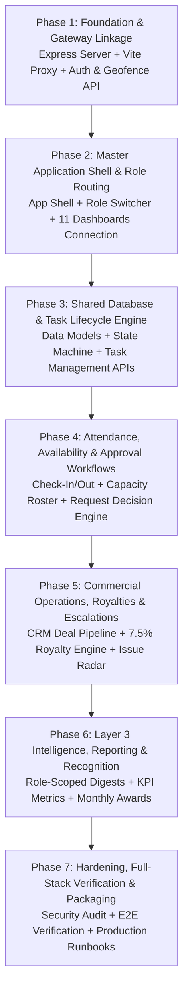

# CIRIL IOTS — Full-Stack Integration & System Implementation Plan
## Based on `documentation/iots-system.drawio`

> **Document Location:** `iots-app/documentation/plan/IOTS_DRAWIO_SYSTEM_STEP_BY_STEP_PLAN.md`  
> **Source Blueprint:** `iots-app/documentation/iots-system.drawio` (Three-Layer Operational Architecture)  
> **Target Systems:** `iots-app/frontend` (React 19 + Vite 8) & `iots-app/backend` (Node.js + Express 5)  
> **Status:** Approved Architectural Blueprint & Phased Execution Roadmap

---

## 1. Executive Summary & Root Cause Analysis

### 1.1 The Current Problem: Why Frontend and Backend Are Disconnected
In the repository under `internal-operations-tracking-system/iots-app/`:
1. **Isolated Processes & Empty Proxy:** `frontend` runs on port `5173` via Vite, but its `vite.config.js` does not have a proxy targeting the backend. Any browser `fetch('/api/...')` results in `404 Not Found` or network errors.
2. **Missing Backend Entry Point:** `backend` contains a `package.json` with dependencies (`express`, `dotenv`), but lacks an active `index.js` server implementation. No API routes exist to receive or respond to frontend requests.
3. **Simulated State in Frontend:** In `frontend/src/App.jsx`, credential validation, geofence checks, and audit logging use client-side `setTimeout` simulations and hardcoded scenarios (`TestingDock.jsx`) rather than real network dispatches.
4. **Decoupled Dashboards:** In `frontend/dashboards/components/`, all 11 role-tailored dashboards (`ChairmanDashboard.jsx`, `SeniorManagerDashboard.jsx`, etc.) exist as static components, but are not imported into the application shell or hydrated with live data from the backend.

### 1.2 The System Architecture in `iots-system.drawio`
The master diagram defines a **Unified 3-Layer Enterprise Operational Flow**:
```
┌─────────────────────────────────────────────────────────────────────────────┐
│ LAYER 1: AUTHENTICATION, GEOLOCATION & SECURITY LAYER                       │
│ - Unified Login (No public registration)                                    │
│ - Hardware GPS & Perimeter Geofencing (Office vs. Remote / Off-Site Tag)    │
│ - Tamper-Proof Audit Logging & Identity Decision                            │
│ - Authorized Workspace Loading & Multi-Role Context Switcher                │
└──────────────────────────────────────┬──────────────────────────────────────┘
                                       │
┌──────────────────────────────────────▼──────────────────────────────────────┐
│ LAYER 2: MANAGEMENT, OPERATIONS & EXECUTION LAYER                           │
│ - 3 Administrative Branches: Admin, Super Admin, IT System Analyst          │
│ - 4 Management Cockpits: Chairman, General Manager, Senior Mgr, Lead Mgr    │
│ - 3 Execution Workbenches: Operations Executive, BDE, Creatives Associate   │
│ - Shared Operational Records & Audit Database (Tasks, Teams, Approvals)     │
│ - Closed-Loop Task Lifecycle: Assigned ➔ Active ➔ Review ➔ Closed           │
│ - Work Activity Logs (Notes, Files, Timers) ≠ Task State                    │
└──────────────────────────────────────┬──────────────────────────────────────┘
                                       │
┌──────────────────────────────────────▼──────────────────────────────────────┐
│ LAYER 3: INTELLIGENCE, ANALYTICS & REPORTING LAYER                          │
│ - Operational Metrics (Performance, Workload, Attendance, SLA Delivery)     │
│ - Exception & Risk Radar (Overdue work, unresolved blockers, burnout)       │
│ - Automated Reports (Daily, Weekly, Monthly Digests)                        │
│ - Business & Commercial Tracking (CRM deals, 7.5% CIRIL royalties)          │
│ - Employee Recognition (Star Performer of the Month & 3-Month Awards)       │
└─────────────────────────────────────────────────────────────────────────────┘
```

---

## 2. Phased Step-by-Step Implementation Roadmap



---

### Phase 1: Foundation & Gateway Linkage (Layer 1 Implementation)
**Goal:** Establish bidirectional communication between Vite (Port 5173) and Express (Port 5000), implementing real authentication, geofence perimeter validation, and SIEM audit logging.

#### Task 1.1: Backend Entry Point & Base Express Gateway
- **File to Create:** `iots-app/backend/index.js`
- **File to Update:** `iots-app/backend/package.json`
- **Actions:**
  1. Initialize Express 5 app listening on `PORT 5000` (`http://127.0.0.1:5000`).
  2. Configure middlewares: JSON body parser, URL-encoded parser, request logger, and CORS headers.
  3. Create health check endpoint `GET /api/v1/health` returning service uptime, active user count, and timestamp.
  4. In `backend/package.json`, add scripts: `"start": "node index.js"` and `"dev": "node --watch index.js"`.
- **Verification:** Run `node index.js` in `backend` and query `http://127.0.0.1:5000/api/v1/health` verifying `status: "UP"`.

#### Task 1.2: Vite Reverse Development Proxy
- **File to Update:** `iots-app/frontend/vite.config.js`
- **Actions:**
  1. Add server proxy configuration mapping `/api` to `http://127.0.0.1:5000`.
  2. Enable `changeOrigin: true` and `secure: false`.
- **Verification:** Start frontend (`npm run dev`) and query `http://localhost:5173/api/v1/health` directly from the browser to confirm proxy routing.

#### Task 1.3: Unified Authentication & Role Resolution API
- **File:** `iots-app/backend/index.js` (Route: `POST /api/v1/auth/verify`)
- **Specification from Draw.io:**
  - System enforces *zero self-registration*; users authenticate using organizational credentials.
  - Returns authenticated user profile, primary role ID, permitted role assignments (for multi-role users), department, office, and a cryptographic session token.
- **Payload Schema:**
  - Request: `{ "empId": "CIRIL-CHAIR-001", "password": "..." }`
  - Response: `{ "success": true, "user": { "empId": "...", "name": "...", "roleId": "chairman", "permittedRoles": ["chairman", "super_admin"] }, "token": "..." }`

#### Task 1.4: Hardware GPS & Geofence Perimeter Engine
- **File:** `iots-app/backend/index.js` (Route: `POST /api/v1/security/geofence-check`)
- **Specification from Draw.io:**
  - Compares client GPS coordinates against authorized corporate perimeters (e.g. Hyderabad Headquarters: Lat `17.448291`, Lon `78.374829`, Radius `350m`).
  - Calculates Haversine distance.
  - If inside perimeter: tags session as `ONSITE` (`isWithinGeofence: true`).
  - If outside perimeter: tags session as `REMOTE` / `OFF-SITE` (`isWithinGeofence: false`) without hard blocking, allowing transparent remote work with managerial visibility.

#### Task 1.5: SIEM Security Audit Logging
- **File:** `iots-app/backend/index.js` (Route: `POST /api/v1/security/audit` & `GET /api/v1/security/audit-trail`)
- **Specification from Draw.io:**
  - Immutably logs session identities, timestamps, GPS coordinates, IP addresses, user-agent strings, and outcome statuses (`OFF_SITE_LOGIN_ACCEPTED`, `OFF_SITE_LOGIN_REJECTED`, etc.).

#### Task 1.6: Wire Real API Dispatches in Frontend
- **File to Update:** `iots-app/frontend/src/App.jsx`
- **Actions:**
  1. In `handleLogin`, dispatch `POST /api/v1/auth/verify`.
  2. In Step 3 of login pipeline, dispatch `POST /api/v1/security/geofence-check`.
  3. If remote mismatch occurs, trigger Option A (accept and log) / Option B (abort and log) dispatching to `/api/v1/security/audit`.
  4. Store session token and user profile in `localStorage` (`iots_auth_token`, `iots_user`).

---

### Phase 2: Master Application Shell & Role Routing
**Goal:** Transition the user from the login form upon success into an enterprise cockpit shell that loads the correct dashboard matching their role.

#### Task 2.1: Install Dashboard Dependencies in Frontend
- **Action:** Run `npm install lucide-react` in `iots-app/frontend` (required by all 11 dashboards in `frontend/dashboards/components/`).

#### Task 2.2: Move & Export Dashboards into Standard Source Tree
- **Directory:** Move/integrate dashboards from `iots-app/frontend/dashboards/components/` into `iots-app/frontend/src/dashboards/`.
- **Create Index Registry:** `iots-app/frontend/src/dashboards/index.js` exporting:
  - `ChairmanDashboard` (`roleId: 'chairman'`)
  - `GeneralManagerDashboard` (`roleId: 'general_manager'`)
  - `SeniorManagerDashboard` (`roleId: 'senior_manager'`)
  - `LeadManagerDashboard` (`roleId: 'lead_manager'`)
  - `ExecutiveDashboard` (`roleId: 'executive'`)
  - `BusinessDevelopmentExecutiveDashboard` (`roleId: 'bde'`)
  - `GraphicDesignerDashboard` (`roleId: 'graphic_designer'` / `'creatives_associate'`)
  - `SocialMediaManagerDashboard` (`roleId: 'social_media'`)
  - `AdminDashboard` (`roleId: 'admin'`)
  - `SuperAdminDashboard` (`roleId: 'super_admin'`)
  - `ITSystemAnalystDashboard` (`roleId: 'it_analyst'`)

#### Task 2.3: Build Master Application Shell
- **File to Create:** `iots-app/frontend/src/components/AppShell.jsx`
- **Specification from Chapter 7 Blueprints:**
  - **Top Bar:** CIRIL Logo, Office Location Tag (`📍 Hyderabad HQ • ONSITE`), Employee Identity & Avatar.
  - **Role Context Switcher Dropdown:** Enables users with multiple role assignments (e.g. Lead Manager switching to Executive, or Super Admin switching to IT Analyst) to toggle active workspaces instantly without re-logging in.
  - **Live Availability Indicator:** Quick toggle (`🟢 Available`, `🟡 In Meeting`, `🔵 On Field Inspection`, `🔴 On Leave`).
  - **Notifications Bell:** Quick drawer for task assignments, escalations, and approval notices.
  - **Logout Action:** Invalidates session and returns cleanly to login portal.

#### Task 2.4: Session Hydration on Page Refresh
- **File:** `iots-app/frontend/src/App.jsx`
- **Actions:** On initial mount (`useEffect`), inspect `localStorage` for `iots_auth_token`. If present, validate session via `GET /api/v1/auth/me` and restore active workspace directly.

---

### Phase 3: Shared Operational Database & Task Lifecycle Engine (Layer 2)
**Goal:** Implement the "SHARED OPERATIONAL RECORDS & AUDIT DATABASE" and the closed-loop task execution lifecycle.

#### Task 3.1: Define Data Store & Schema Entities
- **File to Create:** `iots-app/backend/models/database.js`
- **Schema Entities:**
  1. `Users`: Employee ID, Name, Primary Role, Permitted Roles, Department, Office, Availability Status.
  2. `Tasks`: Task ID, Title, Description, Priority (`Low`, `Medium`, `High`, `Critical`), Deliverables, Due Date, Original Due Date, Current Assignee, Reviewer, State (`ASSIGNED`, `IN_PROGRESS`, `WAITING_FOR_REVIEW`, `UNDER_REVIEW`, `CLOSED`, `REVISION_REQUIRED`).
  3. `TaskActivities`: Activity ID, Task ID, Actor ID, Type (`NOTE`, `PROGRESS_UPDATE`, `ATTACHMENT`, `TIME_LOGGED`), Value, Timestamp.
  4. `TaskReassignments`: Transfer ID, Task ID, Prior Assignee, New Assignee, Reason, Transferred By, Timestamp.
  5. `Attendance`: Record ID, Employee ID, Date, CheckInTime, CheckOutTime, Coordinates, LocationStatus (`ONSITE` / `REMOTE`).
  6. `Requests`: Request ID, Employee ID, Type (`LEAVE`, `PROJECT_EXTENSION`, `BUDGET`, `RESOURCE`), Details, Status (`PENDING`, `APPROVED`, `REJECTED`), DecidedBy.
  7. `Deals`: Deal ID, Property Name, Zone (`North`, `South`, `East`, `West`), Lead Giver ID, Lead Receiver ID, Deal Value, Brokerage Fee, Royalty CIRIL (7.5%), Status.
  8. `AuditLedger`: Event ID, Type, Actor ID, Details, IP, Timestamp.

#### Task 3.2: Implement Task State Machine Invariant
- **Rule from Draw.io (`new-388`):** *"Work Activity ≠ Task State. Progress notes and files are historical records. Task states are strictly controlled by formal lifecycle transitions."*
- **Endpoints in `backend/index.js`:**
  - `GET /api/v1/tasks`: Role-filtered task queries (Executives see their tasks; Managers see team tasks; Chairman sees enterprise overviews).
  - `POST /api/v1/tasks`: Authorized manager allocates task with explicit due date, priority, and reviewer.
  - `PATCH /api/v1/tasks/:id/status`: Transitions state with validation (e.g. only assignee can move to `WAITING_FOR_REVIEW`; only reviewer can move to `CLOSED` or `REVISION_REQUIRED`).
  - `POST /api/v1/tasks/:id/activity`: Logs work progress %, notes, hours, or uploaded files without altering core task identity.
  - `POST /api/v1/tasks/:id/reassign`: Records reassignment event preserving original task ID and due date history.

#### Task 3.3: Wire Live Task Data to Dashboards
- Connect `ExecutiveDashboard` to display live assigned tasks, time logger, and submission button.
- Connect `LeadManagerDashboard` and `SeniorManagerDashboard` to display active review queues, overdue work, and reassignment actions.

---

### Phase 4: Attendance, Availability & Approval Workflows
**Goal:** Track live team availability, attendance check-in/out, and managerial approval queues.

#### Task 4.1: Attendance Clock-In & Location Tagging
- **Endpoints:**
  - `POST /api/v1/attendance/punch`: Records check-in / check-out with GPS coordinates, auto-tagging `ONSITE` vs `REMOTE`.
  - `GET /api/v1/attendance/today`: Returns current attendance roster for the employee and their team.

#### Task 4.2: Real-Time Team Capacity & Status Roster
- **Endpoints:**
  - `GET /api/v1/team/capacity`: Returns team load % (e.g. IT Ops: 78%, BD: 85%, Admin: 45%), active user availability (`Available`, `In Meeting`, `On Field`, `On Leave`).
  - `PATCH /api/v1/team/availability`: Allows employees to change their live availability pill.

#### Task 4.3: Request & Approval Engine
- **Endpoints:**
  - `POST /api/v1/requests`: Employees submit leave, deadline extensions, or resource requests.
  - `GET /api/v1/requests/pending`: Returns pending approvals for Managers.
  - `PATCH /api/v1/requests/:id/decide`: Manager approves/rejects with mandatory feedback note.

---

### Phase 5: Commercial Operations, Royalties & Escalation Radar
**Goal:** Connect BDE and Creatives workflows, CIRIL 7.5% royalty tracking, and risk escalation queues.

#### Task 5.1: Commercial Zonal Pipeline & 7.5% Royalty Tracker
- **Specification from Draw.io (`new-509` / `new-553`):**
  - Nationwide deal sharing across North, South, East, West, Central zones.
  - 30% Lead Giver share, 70% Lead Receiver share.
  - CIRIL corporate collects **7.5% royalty** from each side.
- **Endpoints:**
  - `GET /api/v1/commercial/deals`: Returns pipeline deals with calculated royalties.
  - `POST /api/v1/commercial/deals`: BDE adds new commercial lead / closed transaction.

#### Task 5.2: Creative & Design Delivery Queue
- **Specification from Draw.io (`new-392`):**
  - Design briefs, version uploads, proofreading, revisions, approval, and final published assets.
- **Endpoints:**
  - `GET /api/v1/creatives/queue`: Returns creative assets under drafting, review, or revision.
  - `POST /api/v1/creatives/upload-version`: Uploads new creative iteration with version bump (`v1`, `v2`, `v3`).

#### Task 5.3: Blocker & Exception Escalation Engine
- **Specification from Draw.io (`new-484` - `new-489`):**
  - Combines overdue duration, recurring reassignments, and unresolved blockers into severity tiers (`Low`, `Medium`, `High`, `Critical`).
- **Endpoints:**
  - `GET /api/v1/escalations`: Feeds the Attention Items in `ChairmanDashboard`, `GeneralManagerDashboard`, and `SeniorManagerDashboard`.

---

### Phase 6: Layer 3 Intelligence, Reporting & Recognition
**Goal:** Transform shared operational records into role-scoped digests, performance scorecards, and objective recognition standings.

#### Task 6.1: Metric Aggregation Engine
- **Endpoints:**
  - `GET /api/v1/analytics/performance`: Task completion rate, SLA on-time delivery %, elapsed duration vs active effort.
  - `GET /api/v1/analytics/workload`: Overdue work breakdown, queue depth, capacity balance.

#### Task 6.2: Automated Operational Reports
- **Specification from Draw.io (`new-527` - `new-548`):**
  - **Daily Report:** Today's completions, overdue tasks, blockers, attendance, and tomorrow's priorities.
  - **Weekly Report:** Team delivery, target variance, workload balance, and recurring issues.
  - **Monthly Period Report:** Performance trends, royalty reconciliation, and employee appraisal exports.
- **Endpoints:**
  - `GET /api/v1/reports/:period`: Returns JSON report scoped strictly to the caller's role permissions.

#### Task 6.3: Employee Recognition & Award Engine
- **Specification from Draw.io (`new-512` - `new-513` / `06_EMPLOYEE_PERFORMANCE_REWARD_AND_RECOGNITION_SYSTEM.md`):**
  - Automatically scores monthly criteria: Task completion (>90%), SLA on-time (>90%), low revision rate (<10%), attendance consistency (>95%).
  - Computes **Star Performer of the Month**.
  - Tracks **Three Consecutive Qualifying Months** triggering executive review and Chairman sign-off.
- **Endpoints:**
  - `GET /api/v1/recognition/standings`: Returns active monthly leaderboards and award nominees.

---

### Phase 7: Unified Orchestration & Full-Stack Verification
**Goal:** Package both frontend and backend for seamless, one-command execution and zero-defect operation.

#### Task 7.1: Monorepo Orchestration Scripts
- **File to Create:** `iots-app/package.json`
- **File to Create:** `iots-app/dev.js`
- **Configuration:**
  - Single command `npm run dev` in `iots-app/` boots Express backend (port 5000) and Vite frontend (port 5173) simultaneously.
  - Prefix logs with `[BACKEND]` and `[FRONTEND]`.
  - Handle graceful shutdown on `Ctrl+C`.

#### Task 7.2: End-to-End Test Suite & Verification Matrix
- **Automated Tests:**
  1. `test-health`: Verify backend `/api/v1/health` responds with `200 OK`.
  2. `test-auth`: Authenticate each of the 10 roles, verifying issued role permissions and tokens.
  3. `test-geofence`: Test coordinates inside HQ (350m radius) returns `ONSITE`; test remote coordinates returns `REMOTE`.
  4. `test-audit`: Verify SIEM audit ledger records all login, accept, and abort events.
  5. `test-task-lifecycle`: Create a task -> move to `IN_PROGRESS` -> submit for review -> approve/close.
  6. `test-role-routing`: Verify logging in as Chairman loads Chairman Cockpit; logging in as Executive loads Executive Workbench.

---

## 3. Immediate First Action Items

To start Phase 1 right now:
1. Initialize the Express server in `iots-app/backend/index.js` with port `5000`, CORS, and health check.
2. Update `iots-app/frontend/vite.config.js` to configure the `/api` reverse proxy to `http://127.0.0.1:5000`.
3. Install `lucide-react` in `iots-app/frontend` so all dashboards can render without missing module errors.
4. Replace simulated `setTimeout` in `App.jsx` with real `fetch('/api/v1/auth/verify')` and `fetch('/api/v1/security/geofence-check')`.
5. Create `iots-app/package.json` and `iots-app/dev.js` so running `npm run dev` starts both services together.

---

## 4. Architectural Invariants Checklist (From `iots-system.drawio`)
- [x] **No Public Registration:** Accounts only provisioned by Admin / Super Admin.
- [x] **Transparent Geolocation:** Off-site access is tagged `REMOTE`, never hard-blocked.
- [x] **Multi-Role Switching:** Context switcher updates active permissions without re-logging in.
- [x] **Work Activity ≠ Task State:** Notes, time logs, and uploads append to activity ledger; core task states only change via formal lifecycle transitions.
- [x] **Stable Task Identity:** Reassignments transfer ownership without creating duplicate tasks.
- [x] **Authoritative CRM Boundary:** Financial deals preserve CRM external truth; IOTS tracks internal task execution and 7.5% corporate royalties.
- [x] **Tamper-Proof Audit History:** All logins, decisions, reassignments, and exports append to the immutable audit database.
